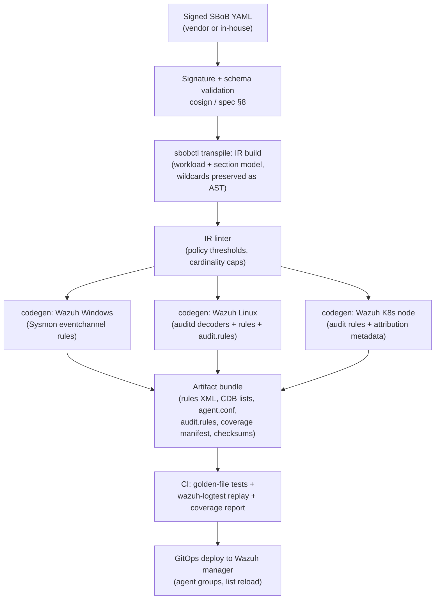
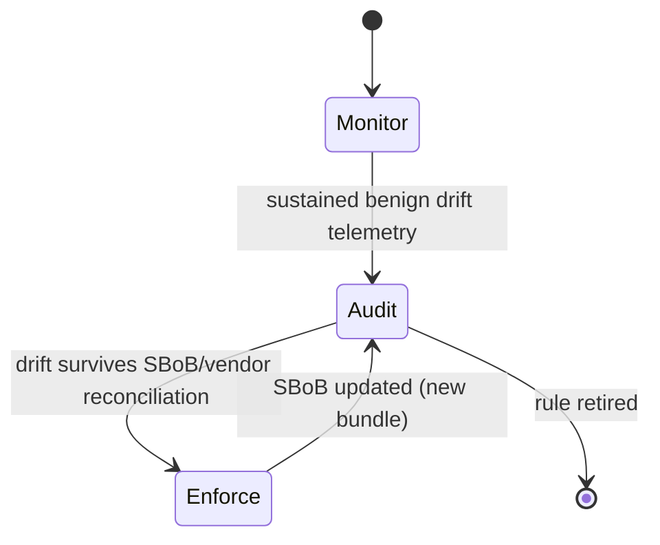

# SBoB → Wazuh Transpiler — Technical Design Specification

**Version:** 1.2-draft · **Date:** 2026-10-28 · **Status:** Proposed (M1 + M2 implementation deviations folded in)
**Author:** Detection Engineering (DevelApp)
**Source standard:** Software Bill of Behavior (SBoB), spec v0.0.4 ([spec](https://billofbehavior.com/bob/docs/spec/), [repo](https://github.com/k8sstormcenter/bob))
**Target platform (Phase 1):** Wazuh 4.x — Windows hosts, Linux hosts, Kubernetes nodes

---

## 1. Scope and objectives

### 1.1 Mission

Build a transpiler that consumes signed SBoB profiles and emits a deployable Wazuh detection ruleset. The ruleset implements **drift detection**: an alert fires when a monitored workload performs a runtime behavior that its SBoB does not declare as intended.

### 1.2 Phase plan

| Phase | Scope | Status |
|---|---|---|
| **1** (this document) | SBoB → Wazuh rules; detection on Windows (Sysmon/eventchannel), Linux (auditd), Kubernetes (node-level auditd + Docker listener) | Design |
| **2** | Same intermediate representation → Sigma (Sysmon + auditd backends), Velociraptor VQL artifacts, Defender for Endpoint KQL hunts, Falco rules; Wazuh as aggregation SIEM | Outlined (§13) |
| **3** | Enforcement: Wazuh active response, seccomp/AppArmor transpile, Kubernetes NetworkPolicy generation, Windows AppLocker/WDAC | Outlined (§14) |

### 1.3 Design principles

1. **Deny-by-exception.** SBoB sections are allowlists; every rule encodes "observed behavior ∉ declared intent ⇒ alert". A missing SBoB section is treated per §5.4 of the spec (absent vs. explicit-empty has distinct semantics — see §8).
2. **One IR, many engines.** Phase 1 emits Wazuh artifacts; the intermediate representation (§5) is engine-neutral so Phase 2 (Sigma/Velociraptor/MDE/Falco) and Phase 3 (enforcement) reuse it without reparsing SBoB.
3. **Deterministic, idempotent codegen.** Same SBoB input ⇒ byte-identical output. Rule IDs, list names, and file names are derived deterministically (§7.1).
4. **Detection, not prevention (Phase 1).** No blocking actions. All rules alert only. Enforcement arrives in Phase 3 behind an explicit rollout state machine.
5. **Honest coverage.** SBoB sections that a target OS cannot observe (e.g. Linux capabilities on Windows) are compiled to *no rules* and reported in a coverage manifest, never silently dropped (§8).

---

## 2. Background

### 2.1 The SBoB source model (v0.0.4)

A signed, declarative YAML profile bound to one container image (`spec.imageID`, ideally digest-pinned). Behavioral sections under `spec`:

| Section | Declares | Phase 1 observable on |
|---|---|---|
| `execs[]` | permitted child processes: `path` (with wildcards) + `args` vector (with `⋯⋯` arg wildcard) | Linux ✅ · Windows ✅ (partial for args) · K8s ✅ |
| `opens[]` | permitted file opens: `path` (wildcards) + open `flags` (`O_RDONLY`, `O_CREAT`, …) | Linux ✅ · Windows ⚠️ partial (§8.2) · K8s ✅ |
| `egress[]` | permitted outbound peers: `ipAddresses[]` (literal/CIDR/`*`), `dnsNames[]` (RFC 4592 wildcards), `podSelector`/`namespaceSelector`, `ports[]` (proto+port; null port = any) | Linux ✅ · Windows ✅ · K8s ✅ (selector-based entries need cluster context, §8.4) |
| `ingress[]` | permitted inbound peers (same shape, symmetric) | Linux ✅ · Windows ✅ (listener-side is host-FW territory, ⚠️) · K8s ✅ |
| `capabilities[]` | Linux capabilities the workload may hold (`CAP_*`) | Linux ✅ · Windows N/A · K8s ✅ |
| `endpoints[]` | HTTP-level endpoints (`:<port>/<path>`, methods, headers, direction) | ⚠️ not directly observable by Wazuh (§8.3) |
| `rulePolicies` | allowlist *who* may perform signature-class actions (`namespace-change`, `module-load`, `ptrace`, `sensitive-file-access`, `execution-from-memory`, `service-account-token-access`, `kubernetes-api-access`, …) keyed by generalized rule name, value = `processAllowed` (comm names) or `containerAllowed: true` | Linux ✅ · Windows partial (per-rule, §8.5) · K8s ✅ |

**Wildcard semantics (spec §5)** — the transpiler MUST implement these exactly:

- `⋯` (U+22EF, single codepoint, not three dots): matches **exactly one** path segment.
- `*` mid-path: matches **zero or more** segments; `*` trailing: matches **one or more** remaining segments (never zero). A bare dir without `*` does not include descendants.
- `args`: `⋯` = exactly one argument; `⋯⋯` = zero or more consecutive arguments; `*` inside `args` is a **literal** asterisk, not a wildcard.
- `dnsNames`: leading `*.suffix` (exactly one label, RFC 4592), mid `a.⋯.b` (one label), trailing `prefix.*` (one or more labels); plain strings are byte-equality (FQDN trailing dot RECOMMENDED).
- Ports: null port = ANY; `ports[]` populated ⇒ only literal (protocol, port) pairs match.
- `ipAddresses`: IPv4/IPv6 literals, CIDR, `*` sentinel = any IP; textual IPv6 canonicalization is the verifier's (here: transpiler's) responsibility.

### 2.2 The Wazuh target model

Relevant Wazuh primitives (4.x):

- **Decoders** (XML): normalize raw log lines / eventchannel events into fields (`decoder.extracted_field`). Linux audit events and Windows eventchannel events have shipped decoder families; Sysmon events are ingested via `<log_format>eventchannel</log_format>` on the agent and decoded from `Event.System` + `EventData`.
- **Rules** (XML): `<rule id level>` with AND-composed conditions: `<if_sid>`, `<match>`, `<regex>` (PCRE2 supported in the ruleset XML syntax), `<field name="x" regex="…">`, `<list field="x" lookup="…" src="…">`, plus `<frequency>`, `<description>`, `<mitre>`, `<group>`.
- **CDB lists**: key-value flat lists under `/var/ossec/etc/lists/`. Rule lookups: `match_key`, `not_match_key`, `address_match_key`, `not_address_match_key`, `match_key_value`, `address_match_key_value`. Address lookups support IP/netmask matching — the natural home for `egress[].ipAddresses` CIDR entries.
- **Agent groups**: per-group `agent.conf` and ruleset scoping; the mechanism used to bind a generated ruleset to "hosts running workload X".
- **Log sources per OS**: Linux agent — auditd via `<localfile>` (`/var/log/audit/audit.log`); Windows agent — eventchannel (Sysmon `Microsoft-Windows-Sysmon/Operational`, Security); Kubernetes — node agents (auditd sees container syscalls, containers share the kernel) + the built-in Docker listener module for container lifecycle events.
- **Active response** (Phase 3 only): `<active-response>` with `firewall-drop` or custom scripts.

---

## 3. System architecture

### 3.1 Pipeline overview



### 3.2 Components

| Component | Form | Responsibility |
|---|---|---|
| `sbobctl transpile` | Standalone **zero-dependency Node/TypeScript CLI** (Node ≥ 22 native type stripping; no npm dependencies — as implemented in M1; replaces the original "extends upstream `bobctl` / Go tool" sketch) | SBoB → IR → engine-specific artifacts |
| IR (Intermediate Representation) | TypeScript types, versioned (`irVersion: 1`) | Engine-neutral model: per-section entries with wildcard ASTs, scope metadata, rule-policy statements |
| `wazuh-gen` | Codegen module (`src/codegen/*`) | IR → rules XML, decoders XML, CDB lists, audit.rules, agent.conf fragments |
| Coverage manifest | JSON in bundle | Section × OS → `covered` / `partial` / `not-applicable` / `gap`, with reason codes |
| Deploy repo | Git | Bundle artifacts reviewed via PR; Wazuh manager pulls via existing configuration management |

### 3.3 Repository layout (deploy side)

```
sbob-detection/
├── wazuh/
│   ├── rules/sbob/            # generated rule files, one per workload
│   ├── decoders/sbob/         # custom decoders (saddr, attribution)
│   ├── lists/sbob/            # CDB allowlists
│   ├── audit/sbob/            # audit.rules fragments per workload
│   └── groups/                # agent.conf fragments per agent group
├── coverage/                  # coverage manifests, CI reports
└── sbobs/                     # pinned SBoB sources (for reproducible builds)
```

---

## 4. Telemetry normalization

All codegen targets consume the same normalized event fields so that rules are structurally identical across OSes. The decoders are responsible for producing these fields; the rules never parse raw formats.

### 4.1 Normalized field contract

| Normalized field | Linux (auditd) source | Windows (Sysmon) source |
|---|---|---|
| `sbob.exe` | SYSCALL `exe=` | EID 1 `Image` |
| `sbob.cmdline` | `PROCTITLE` decoded + argv fields | EID 1 `CommandLine` |
| `sbob.parent_exe` | parent process correlation (decoder-side, via Wazuh audit decoder parent fields) | EID 1 `ParentImage` |
| `sbob.path` | PATH record `name=` | EID 11 `TargetFilename` / EID 10 `TargetImage` |
| `sbob.open_flags` | syscall arg / mode field (`O_*` reconstruction, §7.4.3) | EID 11 (implies create/write), EID 10 (access masks) |
| `sbob.dst_ip` / `sbob.dst_port` | `connect` syscall `saddr=` (custom decoder, §7.3.2) | EID 3 `DestinationIp` / `DestinationPort` |
| `sbob.direction` | connect (out) vs. accept/`Initiated=false` (in) | EID 3 `Initiated` |
| `sbob.dns_query` | (optional, from node DNS capture) | EID 22 `QueryName` |
| `sbob.comm` | `comm=` | process name (Image basename) |
| `sbob.workload` | injected by scoping rule (agent group or cgroup attribution, §6.3) | agent group label |
| `sbob.pod` / `sbob.namespace` | cgroup/audit attribution (§6.3) | n/a |

### 4.2 Linux audit rules (generated per scope)

The transpiler emits `auditctl` fragments using **stable keys** the Wazuh decoders route on:

```
# sbob-exec (node-wide; workload scoping in Wazuh rules)
-a always,exit -F arch=b64 -S execve -k sbob-exec
-a always,exit -F arch=b32 -S execve -k sbob-exec

# sbob-open (file opens with PATH record)
-a always,exit -F arch=b64 -S open,openat -k sbob-open

# sbob-connect (outbound connects; saddr decoded by custom decoder)
-a always,exit -F arch=b64 -S connect -k sbob-connect

# signature-rule syscalls (rulePolicies)
-a always,exit -F arch=b64 -S init_module,finit_module -k sbob-module-load
-a always,exit -F arch=b64 -S unshare,setns -k sbob-namespace-change
-a always,exit -F arch=b64 -S ptrace -k sbob-process-tracing
-a always,exit -F arch=b64 -S memfd_create -k sbob-memfd
```

Volume control: node-wide `execve`/`open` auditing is expensive. Two scoping modes are supported:

- **Mode A — exe-scoped (default where `execs[]` is small and static):** the transpiler emits per-workload `-F exe=`-filtered audit rules. Drastically reduces volume; misses nothing that matters because only declared exes can legitimately run (anything else firing under the node-wide `sbob-exec` rule is itself drift).
- **Mode B — node-wide with workload attribution:** for workloads with wildcarded/unknown exes. Attribution per §6.3.

### 4.3 Windows collection

Per documented Wazuh–Sysmon practice, each Windows agent in a monitored group runs:

```xml
<localfile>
  <location>Microsoft-Windows-Sysmon/Operational</location>
  <log_format>eventchannel</log_format>
  <query>Event/System[EventID=1 or EventID=3 or EventID=10 or EventID=11 or EventID=22]</query>
</localfile>
```

Sysmon (Sysinternals) with a curated config (e.g. SwiftOnSecurity-derived, trimmed to EIDs 1/3/10/11/22) is a deployment prerequisite. Rule-based absence detection is not possible (an agent without Sysmon emits no Sysmon events), so the bundle emits an informational health rule on Sysmon EID 4 (service state change) and the definitive inventory check — alert if a monitored agent lacks Sysmon — is an ops runbook item (M5), using agent inventory data. The generated rules additionally require the shipped Wazuh ruleset entry rule `61600` (`0595-win-sysmon_rules.xml`) and Wazuh ≥ 4.4.

### 4.4 Kubernetes collection

- Wazuh agents run on **nodes** (DaemonSet or host install). Container syscalls are visible to node auditd — Mode A/B from §4.2 applies unchanged.
- The **Docker listener module** (`wodle name="docker-listener"`) provides container start/stop/image events used for drift attribution and for the "binary not in container image" signature rule.
- Kubernetes **API server audit log** is ingested at the manager for `kubernetes-api-access` rule support (distinct pipeline, syslog/webhook → manager port 1515/agentless; out of scope for syscall drift).

---

## 5. Intermediate Representation

### 5.1 IR schema (sketch)

```yaml
irVersion: 1
workload:
  name: redis                  # metadata.name
  namespace: cache-tier        # metadata.namespace
  imageID: docker.io/library/redis@sha256:…
  sbobVersion: 0.0.4
  scope:
    linuxGroups: [sbob-redis]  # Wazuh agent groups (derived, §6.3)
    windowsGroups: [sbob-redis]
    k8s: {namespace: cache-tier, imageID: "docker.io/library/redis@sha256:…"}
sections:
  execs:
    - path: {ast: ["/usr/bin/redis-server"], wildcards: []}
      args: {ast: ["/usr/bin/redis-server", {starstar: true}]}
  opens:
    - path: {ast: ["/data", {trailing: 1}], flags: [O_RDWR, O_CREAT, O_APPEND]}
  egress:
    - identifier: cluster-dns
      ips: [{cidr: "10.96.0.10/32"}]
      dnsNames: []             # exact
      ports: [{proto: UDP, port: 53}]
      k8sPeer: {podSelector: {k8s-app: kube-dns}}   # preserved for k8s codegen
  capabilities: [CAP_NET_BIND_SERVICE]
rulePolicies:
  module-load: {processAllowed: [modprobe]}
coverageNotes: []              # filled by linter (gaps per OS)
```

### 5.2 Wildcard AST → PCRE2 compilation table

The single source of translation truth, used by all regex emitters (Wazuh now, Sigma/Falco later):

| SBoB token (context) | Meaning | PCRE2 fragment (full-match anchored) |
|---|---|---|
| literal path segment | byte equality | escaped literal (see escaping note below) |
| `⋯` mid-path | exactly 1 segment | `[^/]+` |
| `*` mid-path | 0+ segments | `(?:[^/]+/)*` |
| `*` trailing | 1+ segments | `[^/]+(?:/[^/]+)*` |
| `⋯` in `args` | exactly 1 argv token | ` \S+` (space-joined token; argv[0] anchored at string start, §7.4.2) |
| `⋯⋯` in `args` | 0+ argv tokens | `(?: \S+)*` (token-level, §7.4.2) |
| literal `*` in `args` | literal asterisk | ` \*` (escaped literal) |
| DNS `*.suffix.` | exactly one label before suffix | `[^.]+\.suffix\.` |
| DNS `a.⋯.b.` | one label between | `a\.[^.]+\.b\.` |
| DNS `prefix.*.` | 1+ trailing labels | `prefix\.(?:[^.]+\.?)+` |
| IP literal / CIDR / `*` | see §7.2 | compiled to CDB address list, not regex |

**Escaping note (implemented):** `\Q…\E` quoting is deliberately **not** used in emitted fragments. The transpiler escapes literal characters with a standard escapeRegExp routine, producing fragments with identical semantics in PCRE2 and JavaScript RegExp — so the unit-test suite verifies emitted semantics directly with JS `RegExp`, and the emitted ruleset stays portable. Alternations are always wrapped in a non-capturing group before anchoring: positive `^(?:(?:p1|p2))$`, negated `^(?!(?:p1|p2)$)` — the grouping is load-bearing, since without it the `$` would bind to the last alternative only and partial prefixes would leak through the lookahead.

**Combined allow-regex:** for a section with exact entries *E* and pattern entries *P*, the transpiler emits `ALLOW = (?:(?:e1|e2|…)?|(?:p1|p2|…))` — concretely `(?:(?:^e1$)|(?:^p1$)|…)`. When *P* is empty, no regex is emitted and a CDB list alone carries the allowlist. When *E* is empty, only the regex is emitted.

### 5.3 Negated-alternation detection technique

Wazuh rule conditions are AND-composed positive matches. "Value does not fully match any allow pattern" is expressed as one **positive** PCRE2 condition using a negative lookahead over the anchored alternation:

```xml
<!-- fires iff exe is NOT in the allow alternation -->
<field name="sbob.exe" regex="^(?!(?:/usr/bin/redis\-server|/bin/[^/]+)$)"/>
```

Fallbacks if a deployment avoids PCRE2: OS_Regex cannot express negation; the fallback is CDB `not_match_key` for exact entries plus one child rule per pattern with `<if_negate>`-style suppression is **not** supported — therefore PCRE2 is a hard requirement for any SBoB section containing wildcards. The linter enforces this and will fail the build with `ERR_PCRE2_REQUIRED` on non-conforming targets.

---

## 6. Rule set design

### 6.1 Rule ID allocation

Generated IDs live in the **100000–199999** band (Wazuh reserves 1–99999 for the shipped ruleset; custom rule tutorials use ≥100000). Layout, deterministic per workload:

```
rule_id = 100000
        + workload_slot × 100        # workload_slot = stable registry index (docs/sbob-registry.yaml)
        + section_code × 10          # 0 base, 1 execs, 2 opens, 3 egress, 4 ingress,
                                      # 5 capabilities, 6 rulePolicies, 7 attribution
        + variant                     # per-kind digit; layout below (implemented M1)
```

- `workload_slot` is allocated once and never reused (registry is committed).
- A collision (`ERR_ID_COLLISION`) fails the build.
- **Variant digit layout (as implemented; this replaces the original `…0` Linux / `…1` Windows / `…2` k8s sketch):**
  - `0–4` — **Linux / Kubernetes-node** rule kinds: `0` base, `1` drift, `2` sustained-drift escalation, `3` informational, `4` exemption. Linux and k8s-node share this band because k8s nodes run the Linux agent.
  - `5–9` — **Windows** rule kinds: `5` base, `6` drift, `7` sustained-drift escalation, `8` informational, `9` exemption. Windows gets its own band so a workload's Windows and Linux rules for the same section never collide within one slot.
- **Windows secondary-drift allocation (as implemented in M2; amends the sketch above):** execs needs two drift rules (image + args) and egress needs two (ip/port + DNS-name), but a section's variant budget allows one rule per kind. The **base section (code 0)** therefore hosts the secondary drift rules: `(0,6)` = execs args drift (§7.3.4), `(0,7)` = egress DNS-name drift (EID 22); `(0,8)` = Sysmon-prerequisite health (EID 4 informational), `(0,5)` = the global Windows base (chains off shipped rule `61600`).

### 6.2 Rule hierarchy (per workload)

```xml
<!-- 1. Base: normalized event arrived with our audit key / Sysmon EID -->
<rule id="100100" level="0">
  <if_group>auditd</if_group>
  <field name="audit.key">^sbob-exec$</field>
  <description>SBoB base: exec event on sbob scope</description>
  <group>sbob,redis,sbob-exec,</group>
</rule>

<!-- 2. Drift: value not in allowlist (CDB exact + PCRE2 patterns) -->
<rule id="100101" level="9">
  <if_sid>100100</if_sid>
  <list field="sbob.exe" lookup="not_match_key">sbob/redis/execs</list>
  <field name="sbob.exe" regex="^(?!(?:^…patterns…)$)"/>
  <description>SBoB drift: $(sbob.exe) not declared in execs[] of redis SBoB v0.0.4</description>
  <mitre><id>T1059</id></mitre>
  <group>sbob,redis,sbob-drift,process-execution,</group>
  <options>no_full_log</options>
</rule>
```

Notes:

- **PCRE2 hard requirement in `<field>` (engine-verified, M2):** Wazuh `analysisd` compiles rule `<field>` conditions with **OS_Regex by default**; PCRE2 syntax requires the explicit `type="pcre2"` attribute on the `<field>` element (`wazuh/src/analysisd/rules.c`, `Rules_OP_ReadRules` → `w_check_attr_type`; default `EXP_TYPE_OSREGEX`), available since Wazuh 4.4. Every sbobctl-generated field condition therefore carries `type="pcre2"` — character classes (`[^/]+`) and the negated lookaheads would otherwise fail ruleset load.
- **Windows CDB deviation:** Windows drive-letter paths (`C:\…`) cannot be CDB keys (`:` is the key/value separator), so the Windows target compiles execs/opens allowlists as PCRE2 alternations in the rules XML instead of CDB lists; address lists (IPv4/CIDR, canonicalized IPv6) remain CDB `address_match_key` lookups.
- **Sysmon `QueryName` normalization (M2):** SBoB `dnsNames` are canonical DNS zone forms (trailing dot); Sysmon EID 22 `QueryName` carries the hostname **without** the trailing dot, so the Windows DNS drift fragment compiles from the stripped spelling. The Linux path keeps the canonical trailing-dot form for M4 DNS ingestion.
- **Both** the CDB `not_match_key` and the negated-pattern regex must match (AND) ⇒ alert only when the exe is neither an exact nor pattern allowlist member.
- `level="9"` (default drift severity). Alert fields (`sbob.workload`, `sbob.pod`, imageID) are attached by the base rule / decoders so every drift alert carries full context.
- `rulePolicies` **signature rules** invert this: the generic Wazuh rule (e.g. `sbob-module-load`) fires by default; a child rule at `level="0"` with `<if_sid>` + `comm` match on `processAllowed[]` suppresses when the actor is exempt. `containerAllowed: true` ⇒ the transpiler does not emit the rule for that workload at all (per spec §4.8: must not be treated as a deny).
- Repeated-drift escalation: `<frequency>8 / <timeframe>120</timeframe>` child rules raise to `level="12"` for automated ticketing thresholds.

### 6.3 Workload scoping and Kubernetes attribution

- **Linux hosts:** agents are placed in a Wazuh **agent group** per SBoB'd workload they run (e.g. group `sbob-redis`). Group membership is declared in the deploy repo; group-scoped rules only ship to matching agents via `<agent group>` scoping (rules loaded manager-side, evaluated with agent group context). Where a host runs several SBoB'd workloads, Mode A audit rules carry per-workload keys (`sbob-exec-redis`) making the key itself the scope discriminator.
- **Windows hosts:** same agent-group mechanism; `sbob.workload` set from group at decode time.
- **Kubernetes:** attribution is the hard part. Three mechanisms, best-available ordered:
  1. **auditd ≥ 3.0 cgroup emission:** where the node's auditd emits the `cgroup=` field in SYSCALL records, the custom decoder extracts the cgroup path (`…/kubepods.slice/…-<pod-uid>.scope/…`) and maps pod UID → namespace/pod via a periodically refreshed lookup table (CDB list `sbob/k8s/podmap`, refreshed by a node-side script from the local container runtime). This yields true per-pod drift attribution.
  2. **exe-path scoping (Mode A):** audit rules filtered by `-F exe=` per §4.2 — the rule key itself carries the workload identity; attribution is implicit. Recommended default: container filesystems are overlayfs, and exec paths observed through `/proc`/audit `exe=` resolve inside the container's mount namespace, giving high-quality keys for non-wildcarded `execs[]`.
  3. **Fallback (no cgroup field, wildcarded execs):** alerts carry `sbob.workload=unknown-node-scope` and are labeled `attribution=weak` — triage accounts for possible host-process collision.
- Egress/ingress `podSelector`/`namespaceSelector` entries cannot be evaluated from node telemetry without cluster context. For Phase 1, transpiler emits: literal/CIDR/dns parts as rules (fully enforced), and records `k8sPeer` entries in the coverage manifest as `partial — evaluated by Phase-3 NetworkPolicy diff` (§14.3).

### 6.4 CDB list design

One list per (workload, section) where exact entries exist; patterns never go into CDB (PCRE2 only):

```
# /var/ossec/etc/lists/sbob/redis/execs        (key → value)
/usr/bin/redis-server:1
/usr/bin/redis-cli:1

# /var/ossec/etc/lists/sbob/redis/egress_addrs (CDB address list: key = IP[/mask])
10.96.0.10/32:cluster-dns
162.0.217.171/32:stripe-api
```

- `address_match_key` / `not_address_match_key` implement CIDR semantics; the `*` sentinel (any IP) is compiled by *omitting* the address condition entirely (no IP restriction) rather than expanding to `0.0.0.0/0` — same semantics, clearer alerts.
- IPv6 literals are canonicalized (lowercase, expanded form) at transpile time on both sides (list entries and decoder output), per spec §5.7.
- `flags` in `opens[]` are encoded as a value bitmask in `sbob/<wl>/opens` (`key=path, value=flag-bitmask`); the open-drift rule additionally uses `lookup="match_key_value" check_value="…"` where flag discrimination matters, with per-flag child rules for the common cases (`O_CREAT`-only violation, etc.).

---

## 7. Decoder and codegen details

### 7.1 Codegen algorithm

```
for each SBoB in input set:
    verify signature (cosign / spec §8) → else FAIL
    parse & validate schema (hand-rolled structural validator equivalent to the
      spec v0.0.4 JSON Schema; zero-dependency, field-path errors) → else FAIL
    build IR; run linter (policy caps: ≤ 4096 regex bytes/section,
      ≤ 512 execs entries, warn on wildcard breadth > 2 levels)
    for target in {linux, windows, k8s-node}:
        emit decoders (custom only; reuse shipped auditd/sysmon families)
        emit rules XML (base, drift, exemption, escalation)
        emit CDB lists; emit audit.rules fragment (linux/k8s only)
    emit coverage manifest; checksum bundle
```

### 7.2 IP/port egress drift rule (Linux, illustrative)

```xml
<rule id="100300" level="0">
  <if_group>auditd</if_group>
  <field name="audit.key">^sbob-connect$</field>
  <group>sbob,redis,sbob-connect,</group>
  <description>base: outbound connect observed</description>
</rule>
<rule id="100301" level="9">
  <if_sid>100300</if_sid>
  <list field="sbob.dst_ip" lookup="not_address_match_key">sbob/redis/egress_addrs</list>
  <field name="sbob.dst_port" regex="^(?!(?:53|443)$)"/>   <!-- ports[] compiled; null-port entries omit this -->
  <description>SBoB drift: connect to $(sbob.dst_ip):$(sbob.dst_port) not declared in egress[]</description>
  <mitre><id>T1071</id></mitre>
  <group>sbob,redis,sbob-drift,egress-traffic,</group>
</rule>
```

DNS-name drift (Windows EID 22 shown): rule tests `sbob.dns_query` against the negated DNS alternation from §5.2; DNS wildcards never use CDB (byte-exact keys only for plain FQDN entries).

### 7.3 Custom decoders (implementation work items)

1. **`sbob-connect` saddr decoder (Linux):** parse `saddr=0x…` from connect SYSCALL records → `sbob.dst_ip`, `sbob.dst_port`, `sbob.direction`. (Shipped audit decoders do not fully cover AF_INET sockaddr unpacking for this use case.)
2. **cgroup attribution decoder (k8s):** extract `cgroup=` from SYSCALL records → `sbob.pod_uid`; join against `sbob/k8s/podmap` in a `<list lookup="match_key_value">` context rule to stamp `sbob.pod`/`sbob.namespace`.
3. **open-flags reconstruction (Linux):** map `openat` a1 flags bitmask → `O_*` set for `sbob.open_flags` (needed for flag-aware opens drift).
4. **Sysmon arg normalization (Windows):** Sysmon EID 1 gives `CommandLine` (one string), not argv. The transpiler compiles `args[]` ASTs into **token-aware command-line regexes** (`argv[0]` anchored at string start, `⋯⋯` → `(?: .*)?`, quoting variants tolerated) and documents the residual gap: Windows drift on args is *heuristic-equivalent*, flagged `partial` in the coverage manifest.

### 7.4 Signature rules (`rulePolicies`) mapping

| Generalized rule | Wazuh detection primitive (Phase 1) | Windows availability |
|---|---|---|
| `module-load` | audit `sbob-module-load` key → drift unless `comm ∈ processAllowed` | EID 6 (driver load) rule |
| `namespace-change` | audit `sbob-namespace-change` (`unshare`,`setns`) | n/a (no namespaces) |
| `process-tracing` | audit `sbob-process-tracing` (`ptrace`) | EID 10 with suspicious access masks |
| `execution-from-memory` | audit `sbob-memfd` + exe contains `memfd:` | EID 1 Image on `\\Device\...` paths heuristic |
| `sensitive-file-access` | `opens` drift restricted to sensitive-path watchlist; `processAllowed` = comm exemption | EID 10 TargetImage watchlist |
| `service-account-token-access` | open drift on `/var/run/secrets/kubernetes.io/…` | n/a |
| `kubernetes-api-access` | k8s audit-log rule at manager (§4.4) + connect drift to API CIDR | connect drift |
| `binary-not-in-container-image` | Docker listener event + node audit correlate (overlay upper-layer exec) | EID 1 from user-writable paths |

---

## 8. Coverage matrix and known gaps (Phase 1)

| SBoB section | Linux | Windows | Kubernetes |
|---|---|---|---|
| `execs[].path` | ✅ | ✅ | ✅ (attribution §6.3) |
| `execs[].args` | ✅ (argv) | ⚠️ partial — CommandLine regex, not argv | ✅ |
| `opens[].path` | ✅ | ⚠️ partial — EID 11/10 covers create/access; broad read-open telemetry does not exist in Sysmon | ✅ |
| `opens[].flags` | ✅ | ⚠️ implied-only | ✅ |
| `egress[].ipAddresses` | ✅ (CDB address) | ✅ (EID 3) | ✅ |
| `egress[].dnsNames` | ⚠️ needs DNS capture source (node resolver logging or Zeek/Suricata integration) | ✅ (EID 22) | ⚠️ as Linux |
| `egress/ingress[].podSelector` | n/a | n/a | ⚠️ deferred to Phase 3 NetworkPolicy diff |
| `ingress[]` (listener side) | ⚠️ accept() telemetry weaker; recommended: host firewall logs (nftables) via Wazuh | ✅ EID 3 Initiated=false | ⚠️ as Linux |
| `capabilities[]` | ✅ (periodic audit of /proc caps via audit `capset` + baseline) | n/a | ✅ |
| `endpoints[]` (HTTP) | ❌ gap — requires L7 source (proxy/Envoy access logs or Suricata EVE JSON → Wazuh), Phase 2 | ❌ gap | ❌ gap |
| `rulePolicies` | ✅ (§7.4) | ⚠️ per-rule | ✅ |

**Absent vs. explicit-empty (spec §5.4):** absent section ⇒ no drift rules emitted (spec section "carries a different meaning" — absent is not NONE; behaviorally the transpiler treats absent as *unspecified*, emitting a coverage-manifest note `section-absent` and a low-level informational rule so operators notice an SBoB that under-specifies a workload). Explicit empty (`[]`, NONE) ⇒ drift rules with empty allowlist: **every** observed event of that class alerts. The linter requires an operator confirmation flag (`--confirm-none <section>`) for explicit-empty sections, since NONE is a very loud contract.

---

## 9. Worked example (excerpt)

Source: `example/redis` SBoB (abridged) → Linux target.

**Generated audit rules (`audit/sbob/redis.rules`)** — Mode A:

```
-a always,exit -F arch=b64 -S execve -F exe=/usr/bin/redis-server -k sbob-exec-redis
-a always,exit -F arch=b64 -S open,openat -F exe=/usr/bin/redis-server -k sbob-open-redis
-a always,exit -F arch=b64 -S connect -F exe=/usr/bin/redis-server -k sbob-connect-redis
```

**Generated CDB (`lists/sbob/redis/execs`):**

```
/usr/bin/redis-server:1
/usr/bin/redis-cli:1
/bin/sh:1
```

**Generated rule (`rules/sbob/100100_redis.xml`):** drift rule per §6.2; `description`: *"SBoB drift: process $(sbob.exe) not declared in execs[] of redis SBoB v0.0.4 (image redis@sha256:…)"*.

**Windows counterpart:** same base, Windows variant digit (§6.1); condition on Sysmon EID 1; allowlist from identical IR; args drift via §7.3.4 command-line regex.

---

## 10. Deployment and operations

1. **Distribution:** deploy repo PR merges ⇒ CI runs codegen + tests ⇒ artifacts sync to the Wazuh manager (`rules/sbob/`, `lists/sbob/` under `/var/ossec/etc/`); manager restart reloads rules and CDB lists; agent groups receive updated `agent.conf` fragments (audit rules are *not* hot-reloadable — node rollout required, coordinated via the group's config-check rule).
2. **Versioning:** bundle name embeds SBoB version + digest; coverage manifest diffed per release; rollback = previous bundle (git revert).
3. **SBoB update cadence:** mirrors image lifecycle — new image digest ⇒ new SBoB ⇒ new bundle; a rule that alerts "image running without matching SBoB bundle" (Docker listener + registry lookup) closes the drift-of-the-drift-system gap.
4. **Tiering:** drift alerts level 9 → SIEM; frequency-escalated level 12 → ticket; `section-absent` info level 2 → profile-quality backlog.

---

## 11. Testing strategy

1. **Unit:** wildcard AST → PCRE2 golden tests over the spec §5 tables (including the spec's own match/does-not-match examples, e.g. `/etc/⋯` vs `/etc/ssh/sshd_config`).
2. **Rule semantics:** `wazuh-logtest` replay corpus per OS: benign samples (must NOT alert) + drift samples (MUST alert) derived from each SBoB's expected intent.
3. **Attack validation (false-negative checks, per spec §1.1):** upstream `bobctl simulate --suite example/redis-attacks.yaml` generates kill-chain traffic; where the suite targets Kubernetes/Kubescape, we derive equivalent Linux/Windows replay logs from captured runs and assert each attack step either alerts (detected) or appears in the coverage manifest as a documented blind spot. This is the direct analog of the SBoB spec's "test for false-negatives: each attack type can be verified as blind or detectable".
4. **CI gates:** codegen determinism (twice-run byte diff), ID-collision check, PCRE2 size caps, coverage-manifest completeness (every section × OS has a status).

---

## 12. Performance and operational considerations

- auditd node-wide volume (Mode B) can be high on busy nodes: budget ~2–5k events/s worst case; Mode A strongly preferred where `execs[]` allows. Wazuh CDB lookups are O(1) hash — list size is not a scaling concern; regex size is (hence §7.1 caps).
- Negated-alternation regexes are evaluated once per event — measure with `wazuh-logtest --trace` in CI performance profile; break-glass: split oversized alternations into per-pattern child rules with `<if_sid>` chaining at the cost of alert fan-out.
- Dedupe: drift alerts are naturally high-frequency for a genuinely misbehaving workload; the `frequency` escalation child both throttles and signals sustained drift.

---

## 13. Phase 2 — Sigma / Sysmon / Velociraptor / MDE / Falco (outline)

Same IR, additional codegen targets; Wazuh remains the aggregation SIEM.

| Target | Artifact | Notes |
|---|---|---|
| **Sigma** | `logsource: product=windows, service=sysmon` (EID 1/3/11/22) and `product=linux, service=auditd` rule YAML |Community pipelines then convert to Splunk/ Sentinel/etc.; detection YAML generated 1:1 from IR sections; pattern semantics per §5.2 |
| **Velociraptor** | VQL artifacts per workload: scheduled `pslist`/`netstat`-style sweeps asserting SBoB conformance; excellent for *hunt-time* drift and retro-scans | |
| **Defender for Endpoint** | KQL advanced-hunting queries from IR (`DeviceProcessEvents`, `DeviceNetworkEvents`, `DeviceFileEvents`) | covers Windows where Sysmon deployment is not permitted |
| **Falco** | Falco rules using `not in` list semantics (`not proc.exepath in (sbob_execs)`); lists generated from IR; deploy as DaemonSet | Falco alerts → **Falcosidekick → Wazuh manager** (syslog/webhook) so one pane of glass: the transpiler also emits the matching Wazuh-side decoder for falco JSON |
| **HTTP `endpoints[]`** | close the §8 gap via Envoy/nginx access-log ingestion (Wazuh JSON decoder) or Suricata EVE | design debt deliberately parked here |

Phase 2 acceptance: identical attack suite (§11.3) yields a per-engine detectable/blind matrix — engines cover each other's documented blind spots.

---

## 14. Phase 3 — Enforcement (outline)

Rollout state machine per workload:



1. **Wazuh active response:** `firewall-drop` bound to egress/ingress drift rules (Windows + Linux agents); custom AR script for process-kill on exec drift — disabled by default, enabled per agent group.
2. **seccomp transpile (spec-sanctioned):** `execs`/`opens`/syscall surface → seccomp profile applied via pod `securityContext` (K8s) or systemd `SystemCallFilter` (hosts).
3. **AppArmor:** generated profile from `execs`/`opens` sections.
4. **Kubernetes NetworkPolicy:** the spec states an SBoB SHOULD round-trip with NetworkPolicy — generate the NP from `ingress`/`egress`, then **diff declared SBoB against enforced NP** (this is also how §8's `podSelector` entries finally get evaluated).
5. **Windows:** AppLocker/WDAC policy generated from `execs[]` allowlist; delivered via GPO/Intune; WDAC audit-mode mirrors the Monitor→Enforce transition.
6. **Safety:** enforcement MUST only activate for SBoB sections whose drift has been alerting cleanly for a configured window; kill-switch = group config flag; every block event is itself a Wazuh alert (enforcement telemetry).

---

## 15. Milestones

| # | Milestone | Exit criteria |
|---|---|---|
| M1 | IR + linter + Linux codegen (execs/opens/egress) | golden tests green; `wazuh-logtest` corpus passes on a lab node |
| M2 | Windows codegen (Sysmon EIDs 1/3/11/22; opens = file-create partial) | same, on a lab Windows host with Sysmon (`scripts/logtest-corpus.sh windows`) |
| M3 | K8s attribution (Mode A default; cgroup decoder stretch) | redis attack suite matrix published |
| M4 | rulePolicies signature rules + coverage manifest + CI gates | full §8 matrix machine-generated |
| M5 | Deploy-repo GitOps flow + ops runbook | production pilot on one workload |
| M6 | Phase 2 codegen (Sigma, Velociraptor, MDE, Falco) | per-engine blind-spot matrix |
| M7 | Phase 3 enforcement behind state machine | enforcement pilot in Audit mode |

---

## Appendix A — References

- SBoB spec v0.0.4: https://billofbehavior.com/bob/docs/spec/
- SBoB repo (bobctl, example/redis attack suite): https://github.com/k8sstormcenter/bob
- Kubescape Bill-of-Behavior reference implementation: https://kubescape.io/docs/operator/bill-of-behavior/
- Wazuh ruleset XML syntax (incl. PCRE2): https://documentation.wazuh.com/current/user-manual/ruleset/ruleset-xml-syntax/pcre2.html
- Wazuh CDB lists and lookups: https://documentation.wazuh.com/current/user-manual/ruleset/cdb-list.html
- Wazuh Docker/container monitoring: https://documentation.wazuh.com/current/user-manual/capabilities/container-security/monitoring-docker.html
- Falco event sources (Windows not supported): https://falco.org/docs/concepts/event-sources/

## Appendix B — Error codes emitted by the transpiler

| Code | Meaning |
|---|---|
| `ERR_SIGNATURE_INVALID` | SBoB signature verification failed |
| `ERR_SCHEMA_INVALID` | SBoB does not conform to v0.0.4 schema |
| `ERR_PCRE2_REQUIRED` | target lacks PCRE2 and SBoB contains wildcards |
| `ERR_ID_COLLISION` | derived rule ID already allocated |
| `ERR_REGEX_BUDGET` | compiled alternation exceeds size cap |
| `ERR_NONE_UNCONFIRMED` | explicit-empty section without `--confirm-none` |
| `ERR_MISSING_SCOPE` | no agent group / k8s binding for workload |
| `ERR_SECTION_CAP` | section entry count exceeds policy cap (e.g. 512 for `execs`) |
| `ERR_SIGNATURE_UNAVAILABLE` | signature verification required but no verifier available (no cosign binary and no `--skip-signature-verify`) |
| `ERR_YAML_PARSE` | SBoB YAML could not be parsed by the transpiler's YAML-subset parser (loud failure on unsupported constructs: tabs, block scalars, anchors/aliases) |
