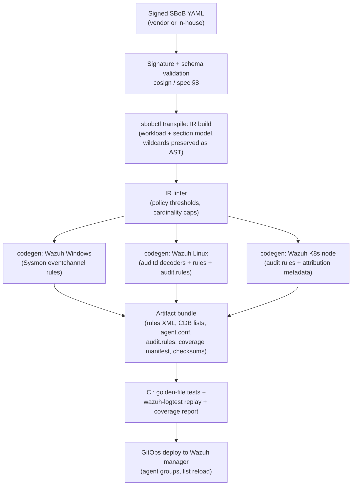
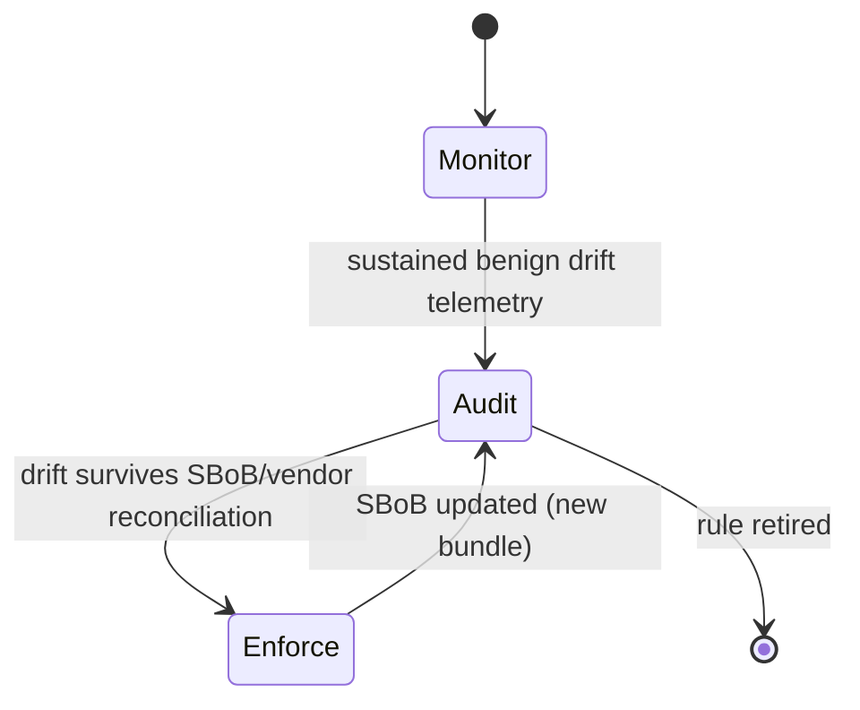

# SBoB → Wazuh Transpiler — Technical Design Specification

**Version:** 1.8-draft · **Date:** 2026-10-28 · **Status:** Proposed (M1 + M2 + M3 + M4 + M5 + M6 + M8 + M7 + M9 implementation deviations folded in)
**Author:** Detection Engineering (DevelApp)
**Source standard:** Software Bill of Behavior (SBoB), spec v0.0.4 ([spec](https://billofbehavior.com/bob/docs/spec/), [repo](https://github.com/k8sstormcenter/bob))
**Target platform (Phase 1):** Wazuh 4.x — Windows hosts, Linux hosts, Kubernetes nodes

---

## 1. Scope and objectives

### 1.1 Mission

Build a transpiler that consumes signed SBoB profiles and emits a deployable Wazuh detection ruleset. The ruleset implements **drift detection**: an alert fires when a monitored workload performs a runtime behavior that its SBoB does not declare as intended.

### 1.2 Phase plan

| Phase | Scope | Status |
|---|---|---|
| **1** (this document) | SBoB → Wazuh rules; detection on Windows (Sysmon/eventchannel), Linux (auditd), Kubernetes (node-level auditd + Docker listener) | Design |
| **2** | Same intermediate representation → Sigma (Sysmon + auditd backends), Velociraptor VQL artifacts, Defender for Endpoint KQL hunts, Falco rules; Wazuh as aggregation SIEM | Outlined (§13) |
| **3** | Enforcement: Wazuh active response, seccomp/AppArmor transpile, Kubernetes NetworkPolicy generation, Windows AppLocker/WDAC | Outlined (§14) |

### 1.3 Design principles

1. **Deny-by-exception.** SBoB sections are allowlists; every rule encodes "observed behavior ∉ declared intent ⇒ alert". A missing SBoB section is treated per §5.4 of the spec (absent vs. explicit-empty has distinct semantics — see §8).
2. **One IR, many engines.** Phase 1 emits Wazuh artifacts; the intermediate representation (§5) is engine-neutral so Phase 2 (Sigma/Velociraptor/MDE/Falco) and Phase 3 (enforcement) reuse it without reparsing SBoB.
3. **Deterministic, idempotent codegen.** Same SBoB input ⇒ byte-identical output. Rule IDs, list names, and file names are derived deterministically (§7.1).
4. **Detection, not prevention (Phase 1).** No blocking actions. All rules alert only. Enforcement arrives in Phase 3 behind an explicit rollout state machine.
5. **Honest coverage.** SBoB sections that a target OS cannot observe (e.g. Linux capabilities on Windows) are compiled to *no rules* and reported in a coverage manifest, never silently dropped (§8).

---

## 2. Background

### 2.1 The SBoB source model (v0.0.4)

A signed, declarative YAML profile bound to one container image (`spec.imageID`, ideally digest-pinned). Behavioral sections under `spec`:

| Section | Declares | Phase 1 observable on |
|---|---|---|
| `execs[]` | permitted child processes: `path` (with wildcards) + `args` vector (with `⋯⋯` arg wildcard) | Linux ✅ · Windows ✅ (partial for args) · K8s ✅ |
| `opens[]` | permitted file opens: `path` (wildcards) + open `flags` (`O_RDONLY`, `O_CREAT`, …) | Linux ✅ · Windows ⚠️ partial (§8.2) · K8s ✅ |
| `egress[]` | permitted outbound peers: `ipAddresses[]` (literal/CIDR/`*`), `dnsNames[]` (RFC 4592 wildcards), `podSelector`/`namespaceSelector`, `ports[]` (proto+port; null port = any) | Linux ✅ · Windows ✅ · K8s ✅ (selector-based entries need cluster context, §8.4) |
| `ingress[]` | permitted inbound peers (same shape, symmetric) | Linux ✅ · Windows ✅ (listener-side is host-FW territory, ⚠️) · K8s ✅ |
| `capabilities[]` | Linux capabilities the workload may hold (`CAP_*`) | Linux ✅ · Windows N/A · K8s ✅ |
| `endpoints[]` | HTTP-level endpoints (`:<port>/<path>`, methods, headers, direction) | ⚠️ not directly observable by Wazuh (§8.3) |
| `rulePolicies` | allowlist *who* may perform signature-class actions (`namespace-change`, `module-load`, `ptrace`, `sensitive-file-access`, `execution-from-memory`, `service-account-token-access`, `kubernetes-api-access`, …) keyed by generalized rule name, value = `processAllowed` (comm names) or `containerAllowed: true` | Linux ✅ · Windows partial (per-rule, §8.5) · K8s ✅ |

**Wildcard semantics (spec §5)** — the transpiler MUST implement these exactly:

- `⋯` (U+22EF, single codepoint, not three dots): matches **exactly one** path segment.
- `*` mid-path: matches **zero or more** segments; `*` trailing: matches **one or more** remaining segments (never zero). A bare dir without `*` does not include descendants.
- `args`: `⋯` = exactly one argument; `⋯⋯` = zero or more consecutive arguments; `*` inside `args` is a **literal** asterisk, not a wildcard.
- `dnsNames`: leading `*.suffix` (exactly one label, RFC 4592), mid `a.⋯.b` (one label), trailing `prefix.*` (one or more labels); plain strings are byte-equality (FQDN trailing dot RECOMMENDED).
- Ports: null port = ANY; `ports[]` populated ⇒ only literal (protocol, port) pairs match.
- `ipAddresses`: IPv4/IPv6 literals, CIDR, `*` sentinel = any IP; textual IPv6 canonicalization is the verifier's (here: transpiler's) responsibility.

### 2.2 The Wazuh target model

Relevant Wazuh primitives (4.x):

- **Decoders** (XML): normalize raw log lines / eventchannel events into fields (`decoder.extracted_field`). Linux audit events and Windows eventchannel events have shipped decoder families; Sysmon events are ingested via `<log_format>eventchannel</log_format>` on the agent and decoded from `Event.System` + `EventData`.
- **Rules** (XML): `<rule id level>` with AND-composed conditions: `<if_sid>`, `<match>`, `<regex>` (PCRE2 supported in the ruleset XML syntax), `<field name="x" regex="…">`, `<list field="x" lookup="…" src="…">`, plus `<frequency>`, `<description>`, `<mitre>`, `<group>`.
- **CDB lists**: key-value flat lists under `/var/ossec/etc/lists/`. Rule lookups: `match_key`, `not_match_key`, `address_match_key`, `not_address_match_key`, `match_key_value`, `address_match_key_value`. Address lookups support IP/netmask matching — the natural home for `egress[].ipAddresses` CIDR entries.
- **Agent groups**: per-group `agent.conf` and ruleset scoping; the mechanism used to bind a generated ruleset to "hosts running workload X".
- **Log sources per OS**: Linux agent — auditd via `<localfile>` (`/var/log/audit/audit.log`); Windows agent — eventchannel (Sysmon `Microsoft-Windows-Sysmon/Operational`, Security); Kubernetes — node agents (auditd sees container syscalls, containers share the kernel) + the built-in Docker listener module for container lifecycle events.
- **Active response** (Phase 3 only): `<active-response>` with `firewall-drop` or custom scripts.

---

## 3. System architecture

### 3.1 Pipeline overview



### 3.2 Components

| Component | Form | Responsibility |
|---|---|---|
| `sbobctl transpile` | Standalone **zero-dependency Node/TypeScript CLI** (Node ≥ 22 native type stripping; no npm dependencies — as implemented in M1; replaces the original "extends upstream `bobctl` / Go tool" sketch) | SBoB → IR → engine-specific artifacts |
| IR (Intermediate Representation) | TypeScript types, versioned (`irVersion: 1`) | Engine-neutral model: per-section entries with wildcard ASTs, scope metadata, rule-policy statements |
| `wazuh-gen` | Codegen module (`src/codegen/*`) | IR → rules XML, decoders XML, CDB lists, audit.rules, agent.conf fragments |
| Coverage manifest | JSON in bundle | Section × OS → `covered` / `partial` / `not-applicable` / `gap`, with reason codes |
| Deploy repo | Git | Bundle artifacts reviewed via PR; Wazuh manager pulls via existing configuration management |

### 3.3 Repository layout (deploy side)

```
sbob-detection/
├── wazuh/
│   ├── rules/sbob/            # generated rule files, one per workload
│   ├── decoders/sbob/         # custom decoders (saddr, attribution)
│   ├── lists/sbob/            # CDB allowlists (rule <list> src is lists-root-relative)
│   ├── audit/sbob/            # audit.rules fragments per workload
│   ├── agent-conf/sbob/       # agent.conf fragments + audit-digest scripts per workload
│   └── manager/               # manager-side setup notes (k8s API audit)
├── *.manifest.json            # per-workload coverage matrix + bundleVersion (M4/M5)
└── sbobs/                     # pinned SBoB sources (for reproducible builds)
```

**Deploy-side flattening (as implemented in M5):** the Wazuh rules/decoders loader does not recurse into subdirectories, so `scripts/sync-manager.sh` flattens `wazuh/rules/sbob/*.xml` → `/var/ossec/rules/sbob_<file>` (decoders likewise), keeps CDB list paths intact (`sbob/**`), and materializes per-workload agent groups under `/var/ossec/etc/shared/sbob-<name>/agent.conf` (concatenating the linux and k8s-node fragments when both exist; the audit-digest script ships in the same shared dir).

---

## 4. Telemetry normalization

All codegen targets consume the same normalized event fields so that rules are structurally identical across OSes. The decoders are responsible for producing these fields; the rules never parse raw formats.

### 4.1 Normalized field contract

| Normalized field | Linux (auditd) source | Windows (Sysmon) source |
|---|---|---|
| `sbob.exe` | SYSCALL `exe=` | EID 1 `Image` |
| `sbob.cmdline` | `PROCTITLE` decoded + argv fields | EID 1 `CommandLine` |
| `sbob.parent_exe` | parent process correlation (decoder-side, via Wazuh audit decoder parent fields) | EID 1 `ParentImage` |
| `sbob.path` | PATH record `name=` | EID 11 `TargetFilename` / EID 10 `TargetImage` |
| `sbob.open_flags` | syscall arg / mode field (`O_*` reconstruction, §7.4.3) | EID 11 (implies create/write), EID 10 (access masks) |
| `sbob.dst_ip` / `sbob.dst_port` | `connect` syscall `saddr=` (custom decoder, §7.3.2) | EID 3 `DestinationIp` / `DestinationPort` |
| `sbob.direction` | connect (out) vs. accept/`Initiated=false` (in) | EID 3 `Initiated` |
| `sbob.dns_query` | (optional, from node DNS capture) | EID 22 `QueryName` |
| `sbob.comm` | `comm=` | process name (Image basename) |
| `sbob.workload` | injected by scoping rule (agent group or cgroup attribution, §6.3) | agent group label |
| `sbob.pod` / `sbob.namespace` | cgroup/audit attribution (§6.3) | n/a |

### 4.2 Linux audit rules (generated per scope)

The transpiler emits `auditctl` fragments using **stable keys** the Wazuh decoders route on:

```
# sbob-exec (node-wide; workload scoping in Wazuh rules)
-a always,exit -F arch=b64 -S execve -k sbob-exec
-a always,exit -F arch=b32 -S execve -k sbob-exec

# sbob-open (file opens with PATH record)
-a always,exit -F arch=b64 -S open,openat -k sbob-open

# sbob-connect (outbound connects; saddr decoded by custom decoder)
-a always,exit -F arch=b64 -S connect -k sbob-connect

# signature-rule syscalls (rulePolicies)
-a always,exit -F arch=b64 -S init_module,finit_module -k sbob-module-load
-a always,exit -F arch=b64 -S unshare,setns -k sbob-namespace-change
-a always,exit -F arch=b64 -S ptrace -k sbob-process-tracing
-a always,exit -F arch=b64 -S memfd_create -k sbob-memfd
```

Volume control: node-wide `execve`/`open` auditing is expensive. Two scoping modes are supported:

- **Mode A — exe-scoped (default where `execs[]` is small and static):** the transpiler emits per-workload `-F exe=`-filtered audit rules. Drastically reduces volume; misses nothing that matters because only declared exes can legitimately run (anything else firing under the node-wide `sbob-exec` rule is itself drift).
- **Mode B — node-wide with workload attribution:** for workloads with wildcarded/unknown exes. Attribution per §6.3.

### 4.3 Windows collection

Per documented Wazuh–Sysmon practice, each Windows agent in a monitored group runs:

```xml
<localfile>
  <location>Microsoft-Windows-Sysmon/Operational</location>
  <log_format>eventchannel</log_format>
  <query>Event/System[EventID=1 or EventID=3 or EventID=10 or EventID=11 or EventID=22]</query>
</localfile>
```

Sysmon (Sysinternals) with a curated config (e.g. SwiftOnSecurity-derived, trimmed to EIDs 1/3/10/11/22) is a deployment prerequisite. Rule-based absence detection is not possible (an agent without Sysmon emits no Sysmon events), so the bundle emits an informational health rule on Sysmon EID 4 (service state change) and the definitive inventory check — alert if a monitored agent lacks Sysmon — is an ops runbook item (M5), using agent inventory data. The generated rules additionally require the shipped Wazuh ruleset entry rule `61600` (`0595-win-sysmon_rules.xml`) and Wazuh ≥ 4.4.

### 4.4 Kubernetes collection

- Wazuh agents run on **nodes** (DaemonSet or host install). Container syscalls are visible to node auditd — Mode A/B from §4.2 applies unchanged.
- The **Docker listener module** (`wodle name="docker-listener"`) provides container start/stop/image events used for drift attribution and for the "binary not in container image" signature rule. *(as implemented, M3)* the lifecycle attribution rule chains off the **shipped** docker integration ruleset (`0560-docker_integration_rules.xml`, parent rule `87900`, json decoder, fields `docker.status` / `docker.Actor.Attributes.image`); the bundle's agent-conf fragment enables the wodle, and the manifest records the shipped-ruleset prerequisite. Container runtimes other than Docker (containerd/cri-o events) are an M4+ follow-up.
- Kubernetes **API server audit log** is ingested at the manager for `kubernetes-api-access` rule support (distinct pipeline, syslog/webhook → manager port 1515/agentless; out of scope for syscall drift).

---

## 5. Intermediate Representation

### 5.1 IR schema (sketch)

```yaml
irVersion: 1
workload:
  name: redis                  # metadata.name
  namespace: cache-tier        # metadata.namespace
  imageID: docker.io/library/redis@sha256:…
  sbobVersion: 0.0.4
  scope:
    linuxGroups: [sbob-redis]  # Wazuh agent groups (derived, §6.3)
    windowsGroups: [sbob-redis]
    k8s: {namespace: cache-tier, imageID: "docker.io/library/redis@sha256:…"}
sections:
  execs:
    - path: {ast: ["/usr/bin/redis-server"], wildcards: []}
      args: {ast: ["/usr/bin/redis-server", {starstar: true}]}
  opens:
    - path: {ast: ["/data", {trailing: 1}], flags: [O_RDWR, O_CREAT, O_APPEND]}
  egress:
    - identifier: cluster-dns
      ips: [{cidr: "10.96.0.10/32"}]
      dnsNames: []             # exact
      ports: [{proto: UDP, port: 53}]
      k8sPeer: {podSelector: {k8s-app: kube-dns}}   # preserved for k8s codegen
  capabilities: [CAP_NET_BIND_SERVICE]
rulePolicies:
  module-load: {processAllowed: [modprobe]}
coverageNotes: []              # filled by linter (gaps per OS)
```

### 5.2 Wildcard AST → PCRE2 compilation table

The single source of translation truth, used by all regex emitters (Wazuh now, Sigma/Falco later):

| SBoB token (context) | Meaning | PCRE2 fragment (full-match anchored) |
|---|---|---|
| literal path segment | byte equality | escaped literal (see escaping note below) |
| `⋯` mid-path | exactly 1 segment | `[^/]+` |
| `*` mid-path | 0+ segments | `(?:[^/]+/)*` |
| `*` trailing | 1+ segments | `[^/]+(?:/[^/]+)*` |
| `⋯` in `args` | exactly 1 argv token | ` \S+` (space-joined token; argv[0] anchored at string start, §7.4.2) |
| `⋯⋯` in `args` | 0+ argv tokens | `(?: \S+)*` (token-level, §7.4.2) |
| literal `*` in `args` | literal asterisk | ` \*` (escaped literal) |
| DNS `*.suffix.` | exactly one label before suffix | `[^.]+\.suffix\.` |
| DNS `a.⋯.b.` | one label between | `a\.[^.]+\.b\.` |
| DNS `prefix.*.` | 1+ trailing labels | `prefix\.(?:[^.]+\.?)+` |
| IP literal / CIDR / `*` | see §7.2 | compiled to CDB address list, not regex |

**Escaping note (implemented):** `\Q…\E` quoting is deliberately **not** used in emitted fragments. The transpiler escapes literal characters with a standard escapeRegExp routine, producing fragments with identical semantics in PCRE2 and JavaScript RegExp — so the unit-test suite verifies emitted semantics directly with JS `RegExp`, and the emitted ruleset stays portable. Alternations are always wrapped in a non-capturing group before anchoring: positive `^(?:(?:p1|p2))$`, negated `^(?!(?:p1|p2)$)` — the grouping is load-bearing, since without it the `$` would bind to the last alternative only and partial prefixes would leak through the lookahead.

**Combined allow-regex:** for a section with exact entries *E* and pattern entries *P*, the transpiler emits `ALLOW = (?:(?:e1|e2|…)?|(?:p1|p2|…))` — concretely `(?:(?:^e1$)|(?:^p1$)|…)`. When *P* is empty, no regex is emitted and a CDB list alone carries the allowlist. When *E* is empty, only the regex is emitted.

### 5.3 Negated-alternation detection technique

Wazuh rule conditions are AND-composed positive matches. "Value does not fully match any allow pattern" is expressed as one **positive** PCRE2 condition using a negative lookahead over the anchored alternation:

```xml
<!-- fires iff exe is NOT in the allow alternation -->
<field name="sbob.exe" regex="^(?!(?:/usr/bin/redis\-server|/bin/[^/]+)$)"/>
```

Fallbacks if a deployment avoids PCRE2: OS_Regex cannot express negation; the fallback is CDB `not_match_key` for exact entries plus one child rule per pattern with `<if_negate>`-style suppression is **not** supported — therefore PCRE2 is a hard requirement for any SBoB section containing wildcards. The linter enforces this and will fail the build with `ERR_PCRE2_REQUIRED` on non-conforming targets.

---

## 6. Rule set design

### 6.1 Rule ID allocation

Generated IDs live in the **100000–199999** band (Wazuh reserves 1–99999 for the shipped ruleset; custom rule tutorials use ≥100000). Layout, deterministic per workload:

```
rule_id = 100000
        + workload_slot × 100        # workload_slot = stable registry index (docs/sbob-registry.yaml)
        + section_code × 10          # 0 base, 1 execs, 2 opens, 3 egress, 4 ingress,
                                      # 5 capabilities, 6 rulePolicies, 7 attribution, 8 ops,
                                      # 9 endpoints, 10 engines
        + variant                     # per-kind digit; layout below (implemented M1)
```

- `workload_slot` is allocated once and never reused (registry is committed).
- A collision (`ERR_ID_COLLISION`) fails the build.
- **Variant digit layout (as implemented; this replaces the original `…0` Linux / `…1` Windows / `…2` k8s sketch):**
  - `0–4` — **Linux / Kubernetes-node** rule kinds: `0` base, `1` drift, `2` sustained-drift escalation, `3` informational, `4` exemption. Linux and k8s-node share this band because k8s nodes run the Linux agent.
  - `5–9` — **Windows** rule kinds: `5` base, `6` drift, `7` sustained-drift escalation, `8` informational, `9` exemption. Windows gets its own band so a workload's Windows and Linux rules for the same section never collide within one slot.
- **Windows secondary-drift allocation (as implemented in M2; amends the sketch above):** execs needs two drift rules (image + args) and egress needs two (ip/port + DNS-name), but a section's variant budget allows one rule per kind. The **base section (code 0)** therefore hosts the secondary drift rules: `(0,6)` = execs args drift (§7.3.4), `(0,7)` = egress DNS-name drift (EID 22); `(0,8)` = Sysmon-prerequisite health (EID 4 informational), `(0,5)` = the global Windows base (chains off shipped rule `61600`).
- **Attribution section semantics (as implemented in M3; Linux/k8s variant band):** the attribution section (code 7) hosts four rules per workload: `(7,0)` = attribution base (level 0; auditd group + `sbob.pod_uid` field), `(7,1)` = podmap-unresolved (level 3; `not_match_key` on `sbob/k8s/podmap` — stale map indicator), `(7,2)` = reserved, `(7,3)` = weak-fallback (level 3; node-scoped Mode B keys), `(7,4)` = container lifecycle (level 3; chains off the shipped docker integration parent rule `87900`, `docker.status=start` + image-repo match).
- **Ops-health section (as implemented in M5; section code 8):** the ops section hosts two rules per workload, Linux/k8s variant band: `(8,1)` = sbob-cadence (level 9; k8s target only, chains off the shipped docker integration parent rule `87900`, fires on `docker.status=start` when the image reference is repo-matching but digest-mismatched; only digest-bearing refs are verifiable, tag-only starts are not alerted) and `(8,3)` = config-check (level 5; linux + k8s targets, fires from the command-wodle digest line when the node’s installed sbob audit key-set digest differs from the bundle — audit rules are not hot-reloadable, TDS 10.1). The digest is sha256 over the sorted unique `-k sbob…` keys of the generated audit fragment. Windows emits no ops rules (no auditd); all manifests carry `sbobVersion`/`imageID`/`bundleVersion` (`sbob-v<ver>-<digest12>`, or `-untagged` for tag-pinned images).
- **Signature-rule layout (as implemented in M4; amends the §6.2 sketch):** `rulePolicies` (code 6) hosts four agent-side signature rules, all Linux/k8s variant band: `(6,0)` = module-load (level 12, T1547.006), `(6,1)` = namespace-change (level 10, T1611), `(6,2)` = process-tracing (level 10, T1055.008), `(6,3)` = execution-from-memory (level 10, T1620); `(6,4)` = the manager-side JSON rule for `kubernetes-api-access` (k8s target only, level 12, T1552.001). The remaining four signature behaviors are **base-section overlays** (code 0): `(0,1)` = sensitive-file-access (child of the opens drift rule), `(0,2)` = service-account-token-access (child of opens drift), `(0,3)` = kubernetes-api-access connect overlay (child of egress drift), `(0,4)` = binary-not-in-container-image (informational correlate, child of the container-lifecycle rule; cross-event correlation is not a single-event rule, so it is documented as a triage entry point). Overlays are emitted **only when the parent drift rule exists** (parent ids computed via the raw-id formula, never re-allocated — the allocator throws `ERR_ID_COLLISION` on double allocation).
- **Endpoints and engines sections (as implemented in M6; section codes 9 and 10):** the `endpoints` section (code 9) exists only on the k8s target (Envoy access-log ingestion, §13): `(9,1)` = inbound HTTP endpoint drift (level 9, manager-side, `direction` field + `not_match_key` on the `endpoints_in` CDB list), `(9,2)` = outbound endpoint drift (level 9, `endpoints_out`) — the outbound rule uses variant digit 2 because variant 2 is the sustained-drift-escalation kind on the linux band, and endpoint drift is a distinct rule rather than an escalation; documented deviation. The `engines` section (code 10) hosts `(10,3)` = falco alert correlation (level 3; k8s target only, fires on falco-sidekick JSON `output_fields.container.name` matching the workload — the falco bundle raised the event, this rule surfaces it beside the auditd bundle in one pane). Rules are emitted only when the corresponding engine artifacts are part of the bundle; ids come from the allocator as usual (never re-allocated).
- **Enforcement section (as implemented in M7; section code 11):** the enforcement section hosts exactly one rule per workload, Linux/k8s variant band: `(11,1)` = enforcement-telemetry (level 10, manager-side, fires on the `sbob-enforce.log` json localfile for active-response actions `process-kill` / `-revert` / `-failed` / `firewall-drop`, scoped by `sbob_workload`). Active responses themselves bind to the existing drift rules — `(1,1)` exec, `(3,1)` egress, `(4,1)` ingress — and never allocate additional ids; the enforcement artifacts live under `enforcement/sbob/<name>/` outside the rule-id band's meaning (no Wazuh rules).

### 6.2 Rule hierarchy (per workload)

```xml
<!-- 1. Base: normalized event arrived with our audit key / Sysmon EID -->
<rule id="100100" level="0">
  <if_group>auditd</if_group>
  <field name="audit.key">^sbob-exec$</field>
  <description>SBoB base: exec event on sbob scope</description>
  <group>sbob,redis,sbob-exec,</group>
</rule>

<!-- 2. Drift: value not in allowlist (CDB exact + PCRE2 patterns) -->
<rule id="100101" level="9">
  <if_sid>100100</if_sid>
  <list field="sbob.exe" lookup="not_match_key">sbob/redis/execs</list>
  <field name="sbob.exe" regex="^(?!(?:^…patterns…)$)"/>
  <description>SBoB drift: $(sbob.exe) not declared in execs[] of redis SBoB v0.0.4</description>
  <mitre><id>T1059</id></mitre>
  <group>sbob,redis,sbob-drift,process-execution,</group>
  <options>no_full_log</options>
</rule>
```

Notes:

- **PCRE2 hard requirement in `<field>` (engine-verified, M2):** Wazuh `analysisd` compiles rule `<field>` conditions with **OS_Regex by default**; PCRE2 syntax requires the explicit `type="pcre2"` attribute on the `<field>` element (`wazuh/src/analysisd/rules.c`, `Rules_OP_ReadRules` → `w_check_attr_type`; default `EXP_TYPE_OSREGEX`), available since Wazuh 4.4. Every sbobctl-generated field condition therefore carries `type="pcre2"` — character classes (`[^/]+`) and the negated lookaheads would otherwise fail ruleset load.
- **Windows CDB deviation:** Windows drive-letter paths (`C:\…`) cannot be CDB keys (`:` is the key/value separator), so the Windows target compiles execs/opens allowlists as PCRE2 alternations in the rules XML instead of CDB lists; address lists (IPv4/CIDR, canonicalized IPv6) remain CDB `address_match_key` lookups.
- **Sysmon `QueryName` normalization (M2):** SBoB `dnsNames` are canonical DNS zone forms (trailing dot); Sysmon EID 22 `QueryName` carries the hostname **without** the trailing dot, so the Windows DNS drift fragment compiles from the stripped spelling. The Linux path keeps the canonical trailing-dot form for M4 DNS ingestion.
- **Both** the CDB `not_match_key` and the negated-pattern regex must match (AND) ⇒ alert only when the exe is neither an exact nor pattern allowlist member.
- `level="9"` (default drift severity). Alert fields (`sbob.workload`, `sbob.pod`, imageID) are attached by the base rule / decoders so every drift alert carries full context.
- `rulePolicies` **signature rules** invert this: the generic Wazuh rule (e.g. `sbob-module-load`) fires by default. *(as implemented, M4)* exemptions use a **CDB list condition, not a level-0 child rule** (deviation from this sketch — it saves a variant digit per policy): each policy with `processAllowed[]` gets a per-policy list `sbob/<workload>/sigexempts/<policy>` (key = `comm`) and the rule itself carries `<list field="sbob.comm" lookup="not_match_key">`, so the rule fires only when the actor is not exempt. `containerAllowed: true` ⇒ the transpiler does not emit the rule or its audit line for that workload at all (per spec §4.8: must not be treated as a deny). Audit keys for signature rules are node-scoped (Mode B, attribution-weak) — a documented caveat: workloads that share a node with the container runtime must declare `processAllowed` for the runtime’s `comm`s.
- Repeated-drift escalation: `<frequency>8 / <timeframe>120</timeframe>` child rules raise to `level="12"` for automated ticketing thresholds.

### 6.3 Workload scoping and Kubernetes attribution

- **Linux hosts:** agents are placed in a Wazuh **agent group** per SBoB'd workload they run (e.g. group `sbob-redis`). Group membership is declared in the deploy repo; group-scoped rules only ship to matching agents via `<agent group>` scoping (rules loaded manager-side, evaluated with agent group context). Where a host runs several SBoB'd workloads, Mode A audit rules carry per-workload keys (`sbob-exec-redis`) making the key itself the scope discriminator.
- **Windows hosts:** same agent-group mechanism; `sbob.workload` set from group at decode time.
- **Kubernetes:** attribution is the hard part. Three mechanisms, best-available ordered:
  1. **auditd ≥ 3.0 cgroup emission:** where the node's auditd emits the `cgroup=` field in SYSCALL records, the custom decoder extracts the cgroup path (`…/kubepods.slice/…-<pod-uid>.scope/…`) and maps pod UID → namespace/pod via a periodically refreshed lookup table (CDB list `sbob/k8s/podmap`, refreshed by a node-side script from the local container runtime). This yields true per-pod drift attribution.
     - *(as implemented, M3)* pod UIDs are **hex UUIDs**, and the cgroup spelling varies by driver: cgroup v2/systemd escapes UID dashes as underscores (`…-pod0f3c8ed9_9d6b_…_1234.scope`), the cgroup v2 dash-variant keeps them (`…-pod0f3c8ed9-9d6b-…-1234.scope`), and cgroup v1 uses `/kubepods/<qos>/pod<uid>/<cid>/`. Three **sibling decoders** (all OS_Regex-safe — no character classes, no bounded quantifiers, no lookarheads) extract `sbob.pod_uid` from each form; the podmap refresh script (`scripts/sbob-podmap-refresh.sh`, crictl or docker backend) emits **both spellings per pod** because CDB lookups are exact-match.
  2. **exe-path scoping (Mode A):** audit rules filtered by `-F exe=` per §4.2 — the rule key itself carries the workload identity; attribution is implicit. Recommended default: container filesystems are overlayfs, and exec paths observed through `/proc`/audit `exe=` resolve inside the container's mount namespace, giving high-quality keys for non-wildcarded `execs[]`.
  3. **Fallback (no cgroup field, wildcarded execs):** alerts carry `sbob.workload=unknown-node-scope` and are labeled `attribution=weak` — triage accounts for possible host-process collision.
- Egress/ingress `podSelector`/`namespaceSelector` entries cannot be evaluated from node telemetry without cluster context. For Phase 1, transpiler emits: literal/CIDR/dns parts as rules (fully enforced), and records `k8sPeer` entries in the coverage manifest as `partial — evaluated by Phase-3 NetworkPolicy diff` (§14.3).

### 6.4 CDB list design

One list per (workload, section) where exact entries exist; patterns never go into CDB (PCRE2 only):

```
# /var/ossec/etc/lists/sbob/redis/execs        (key → value)
/usr/bin/redis-server:1
/usr/bin/redis-cli:1

# /var/ossec/etc/lists/sbob/redis/egress_addrs (CDB address list: key = IP[/mask])
10.96.0.10/32:cluster-dns
162.0.217.171/32:stripe-api
```

- `address_match_key` / `not_address_match_key` implement CIDR semantics; the `*` sentinel (any IP) is compiled by *omitting* the address condition entirely (no IP restriction) rather than expanding to `0.0.0.0/0` — same semantics, clearer alerts.
- IPv6 literals are canonicalized (lowercase, expanded form) at transpile time on both sides (list entries and decoder output), per spec §5.7.
- `flags` in `opens[]` are encoded as a value bitmask in `sbob/<wl>/opens` (`key=path, value=flag-bitmask`); the open-drift rule additionally uses `lookup="match_key_value" check_value="…"` where flag discrimination matters, with per-flag child rules for the common cases (`O_CREAT`-only violation, etc.).

---

## 7. Decoder and codegen details

### 7.1 Codegen algorithm

```
for each SBoB in input set:
    verify signature (cosign / spec §8) → else FAIL
    parse & validate schema (hand-rolled structural validator equivalent to the
      spec v0.0.4 JSON Schema; zero-dependency, field-path errors) → else FAIL
    build IR; run linter (policy caps: ≤ 4096 regex bytes/section,
      ≤ 512 execs entries, warn on wildcard breadth > 2 levels)
    for target in {linux, windows, k8s-node}:
        emit decoders (custom only; reuse shipped auditd/sysmon families)
        emit rules XML (base, drift, exemption, escalation)
        emit CDB lists; emit audit.rules fragment (linux/k8s only)
    emit coverage manifest; checksum bundle
```

### 7.2 IP/port egress drift rule (Linux, illustrative)

```xml
<rule id="100300" level="0">
  <if_group>auditd</if_group>
  <field name="audit.key">^sbob-connect$</field>
  <group>sbob,redis,sbob-connect,</group>
  <description>base: outbound connect observed</description>
</rule>
<rule id="100301" level="9">
  <if_sid>100300</if_sid>
  <list field="sbob.dst_ip" lookup="not_address_match_key">sbob/redis/egress_addrs</list>
  <field name="sbob.dst_port" regex="^(?!(?:53|443)$)"/>   <!-- ports[] compiled; null-port entries omit this -->
  <description>SBoB drift: connect to $(sbob.dst_ip):$(sbob.dst_port) not declared in egress[]</description>
  <mitre><id>T1071</id></mitre>
  <group>sbob,redis,sbob-drift,egress-traffic,</group>
</rule>
```

DNS-name drift (Windows EID 22 shown): rule tests `sbob.dns_query` against the negated DNS alternation from §5.2; DNS wildcards never use CDB (byte-exact keys only for plain FQDN entries).

### 7.3 Custom decoders (implementation work items)

1. **`sbob-connect` saddr decoder (Linux):** parse `saddr=0x…` from connect SYSCALL records → `sbob.dst_ip`, `sbob.dst_port`, `sbob.direction`. (Shipped audit decoders do not fully cover AF_INET sockaddr unpacking for this use case.)
2. **cgroup attribution decoder (k8s):** extract `cgroup=` from SYSCALL records → `sbob.pod_uid`; join against `sbob/k8s/podmap` in a `<list lookup="match_key_value">` context rule to stamp `sbob.pod`/`sbob.namespace`. *(as implemented, M3 — deviation:)* Wazuh rules **cannot inject CDB list values into alert fields** (list lookups are boolean membership/address assertions only, `wazuh/src/analysisd/lists.c`), so "stamping" is delivered differently: the decoders carry `sbob.pod_uid` on every alert, the podmap's value column (`namespace/podname`) serves as the triage lookup, and the rules *assert* map membership — `(7,1)` fires `not_match_key` when the uid is absent (stale map), silence of `(7,1)` plus presence of the uid means tier-1 attribution resolved.
3. **open-flags reconstruction (Linux):** map `openat` a1 flags bitmask → `O_*` set for `sbob.open_flags` (needed for flag-aware opens drift).
4. **Sysmon arg normalization (Windows):** Sysmon EID 1 gives `CommandLine` (one string), not argv. The transpiler compiles `args[]` ASTs into **token-aware command-line regexes** (`argv[0]` anchored at string start, `⋯⋯` → `(?: .*)?`, quoting variants tolerated) and documents the residual gap: Windows drift on args is *heuristic-equivalent*, flagged `partial` in the coverage manifest.

### 7.4 Signature rules (`rulePolicies`) mapping

| Generalized rule | Wazuh detection primitive (Phase 1) | Windows availability |
|---|---|---|
| `module-load` | audit `sbob-module-load` key → drift unless `comm ∈ processAllowed` | EID 6 (driver load) rule |
| `namespace-change` | audit `sbob-namespace-change` (`unshare`,`setns`) | n/a (no namespaces) |
| `process-tracing` | audit `sbob-process-tracing` (`ptrace`) | EID 10 with suspicious access masks |
| `execution-from-memory` | audit `sbob-memfd` + exe contains `memfd:` | EID 1 Image on `\\Device\...` paths heuristic |
| `sensitive-file-access` | `opens` drift restricted to sensitive-path watchlist; `processAllowed` = comm exemption | EID 10 TargetImage watchlist |
| `service-account-token-access` | open drift on `/var/run/secrets/kubernetes.io/…` | n/a |
| `kubernetes-api-access` | k8s audit-log rule at manager (§4.4) + connect drift to API CIDR | connect drift |
| `binary-not-in-container-image` | Docker listener event + node audit correlate (overlay upper-layer exec) | EID 1 from user-writable paths |

*(as implemented, M4)* — IDs per §6.1: module-load = `(6,0)` 100060, namespace-change = `(6,1)` 100061, process-tracing = `(6,2)` 100062, execution-from-memory = `(6,3)` 100063, manager JSON rule = `(6,4)` 100064 (k8s target only; fields `object.user.username` = `^system:serviceaccount:<namespace>:<name>$` and `object.objectRef.resource` = `^(?:secrets|configmaps)$`), sensitive-file-access = `(0,1)` 100001, service-account-token-access = `(0,2)` 100002, k8s-API-connect overlay = `(0,3)` 100003 (default service CIDR `10.96.0.0/12`), binary-not-in-image = `(0,4)` 100004 (informational correlate, level 3). Linux signature rules ship with the default pack whenever the SBoB omits `rulePolicies` (fire-by-default); Windows signature rules are **deferred** (coverage status `partial`, reason `SIG_WIN_DEFERRED`) — the EID 6/10/1 primitives above are the Phase-2 follow-up.

---

## 8. Coverage matrix and known gaps (Phase 1)

| SBoB section | Linux | Windows | Kubernetes |
|---|---|---|---|
| `execs[].path` | ✅ | ✅ | ✅ (attribution §6.3) |
| `execs[].args` | ✅ (argv) | ⚠️ partial — CommandLine regex, not argv | ✅ |
| `opens[].path` | ✅ | ⚠️ partial — EID 11/10 covers create/access; broad read-open telemetry does not exist in Sysmon | ✅ |
| `opens[].flags` | ✅ | ⚠️ implied-only | ✅ |
| `egress[].ipAddresses` | ✅ (CDB address) | ✅ (EID 3) | ✅ |
| `egress[].dnsNames` | ⚠️ needs DNS capture source (node resolver logging or Zeek/Suricata integration) | ✅ (EID 22) | ⚠️ as Linux |
| `egress/ingress[].podSelector` | n/a | n/a | ⚠️ deferred to Phase 3 NetworkPolicy diff |
| `ingress[]` (listener side) | ⚠️ accept() telemetry weaker; recommended: host firewall logs (nftables) via Wazuh | ✅ EID 3 Initiated=false | ⚠️ as Linux |
| `capabilities[]` | ✅ (periodic audit of /proc caps via audit `capset` + baseline) | n/a | ✅ |
| `endpoints[]` (HTTP) | ❌ gap — requires L7 source (proxy/Envoy access logs or Suricata EVE JSON → Wazuh), Phase 2 | ❌ gap | ❌ gap |
| `rulePolicies` | ✅ (§7.4) | ⚠️ per-rule | ✅ |

**Absent vs. explicit-empty (spec §5.4):** absent section ⇒ no drift rules emitted (spec section "carries a different meaning" — absent is not NONE; behaviorally the transpiler treats absent as *unspecified*, emitting a coverage-manifest note `section-absent` and a low-level informational rule so operators notice an SBoB that under-specifies a workload). Explicit empty (`[]`, NONE) ⇒ drift rules with empty allowlist: **every** observed event of that class alerts. The linter requires an operator confirmation flag (`--confirm-none <section>`) for explicit-empty sections, since NONE is a very loud contract. For `rulePolicies` *(as implemented, M4)*, absent means the **default signature pack ships with fire-by-default semantics** (no exemptions), while explicit empty (`{}`, NONE) means no signature protection and requires `--confirm-none rulePolicies`.

*(as implemented, M4)* the table above is the human summary; the **machine-generated matrix** (18 canonical rows × linux/windows/k8s with statuses `covered`/`partial`/`absent`/`gap`/`not-applicable` plus `REASON_CODES`) is emitted as the `coverage` key of every bundle manifest (`src/coverage.ts`: `buildCoverageMatrix`; `assertCoverageComplete` throws at codegen time, making the §11.4 completeness gate a build failure rather than a review checklist).

---

## 9. Worked example (excerpt)

Source: `example/redis` SBoB (abridged) → Linux target.

**Generated audit rules (`audit/sbob/redis.rules`)** — Mode A:

```
-a always,exit -F arch=b64 -S execve -F exe=/usr/bin/redis-server -k sbob-exec-redis
-a always,exit -F arch=b64 -S open,openat -F exe=/usr/bin/redis-server -k sbob-open-redis
-a always,exit -F arch=b64 -S connect -F exe=/usr/bin/redis-server -k sbob-connect-redis
```

**Generated CDB (`lists/sbob/redis/execs`):**

```
/usr/bin/redis-server:1
/usr/bin/redis-cli:1
/bin/sh:1
```

**Generated rule (`rules/sbob/100100_redis.xml`):** drift rule per §6.2; `description`: *"SBoB drift: process $(sbob.exe) not declared in execs[] of redis SBoB v0.0.4 (image redis@sha256:…)"*.

**Windows counterpart:** same base, Windows variant digit (§6.1); condition on Sysmon EID 1; allowlist from identical IR; args drift via §7.3.4 command-line regex.

---

## 10. Deployment and operations

1. **Distribution:** deploy repo PR merges ⇒ CI runs codegen + tests ⇒ artifacts sync to the Wazuh manager (`rules/sbob/`, `lists/sbob/` under `/var/ossec/etc/`); manager restart reloads rules and CDB lists; agent groups receive updated `agent.conf` fragments (audit rules are *not* hot-reloadable — node rollout required, coordinated via the group's config-check rule).
2. **Versioning:** bundle name embeds SBoB version + digest; coverage manifest diffed per release; rollback = previous bundle (git revert).
3. **SBoB update cadence:** mirrors image lifecycle — new image digest ⇒ new SBoB ⇒ new bundle; a rule that alerts "image running without matching SBoB bundle" (Docker listener + registry lookup) closes the drift-of-the-drift-system gap.
4. **Tiering:** drift alerts level 9 → SIEM; frequency-escalated level 12 → ticket; `section-absent` info level 2 → profile-quality backlog.

**As implemented in M5:**

- **Config-check (10.1):** the bundle ships a command-wodle fragment (`wazuh/agent-conf/sbob/<name>.xml`, merged into the k8s fragment when transpiling k8s-node) plus `<name>-audit-digest.sh`, which reports the node’s installed sbob key-set digest every 30m; rule (8,3) compares it against the bundle’s expected digest (decoder `sbob-<name>-config-check`, order `sbob.audit_digest`) and stays silent while the node matches. It is the audit-rollout completion signal. Caveat: multi-workload nodes see it fire on any workload’s key-set difference — the agent-group model is single-workload per node (docs/runbook.md §6).
- **Sync (10.2):** `scripts/sync-manager.sh <bundle-dir> [--root /var/ossec] [--dry-run]` performs the mapping in §3.3 (rules/decoders flattened, lists path-preserved, agent groups materialized with the digest script). Rollback = git revert + re-sync + restart; node audit revert follows the rollout procedure.
- **Bundle versioning (10.2):** each manifest carries `bundleVersion` = `sbob-v<sbobVersion>-<imageDigest12>` (or `-untagged`), tying the deployed rule set to the pinned image generation.
- **Cadence (10.3):** rule (8,1) sbob-cadence alerts when a container starts from the workload’s image repo with a digest that differs from the SBoB-pinned imageID, closing the drift-of-the-drift-system gap. Only digest-bearing image references are verifiable from docker events — tag-only starts are not alerted; the manifest notes this via a coverage note when the imageID is tag-pinned.
- **Pilot (10.4):** the production pilot checklist (deploy, agent-group binding, silence/fires per family, config-check silence, tiering exercise, rollback rehearsal) is docs/runbook.md §7; lab evidence remains automated in CI (logtest corpus, coverage manifest, determinism, attack false-negative suite).

---

## 11. Testing strategy

1. **Unit:** wildcard AST → PCRE2 golden tests over the spec §5 tables (including the spec's own match/does-not-match examples, e.g. `/etc/⋯` vs `/etc/ssh/sshd_config`).
2. **Rule semantics:** `wazuh-logtest` replay corpus per OS: benign samples (must NOT alert) + drift samples (MUST alert) derived from each SBoB's expected intent.
3. **Attack validation (false-negative checks, per spec §1.1):** upstream `bobctl simulate --suite example/redis-attacks.yaml` generates kill-chain traffic; where the suite targets Kubernetes/Kubescape, we derive equivalent Linux/Windows replay logs from captured runs and assert each attack step either alerts (detected) or appears in the coverage manifest as a documented blind spot. This is the direct analog of the SBoB spec's "test for false-negatives: each attack type can be verified as blind or detectable". *(wired, M4)* the harness `scripts/attack-false-negative-check.ts` (`src/attackcheck.ts`) parses `docs/upstream-redis-attacks.yaml` and asserts every attack has a `docs/attack-matrix.md` row with a detection rule id or a documented blind class; it runs in CI and exits non-zero on any gap.
4. **CI gates:** codegen determinism (twice-run byte diff), ID-collision check, PCRE2 size caps, coverage-manifest completeness (every section × OS has a status). *(wired, M4)* determinism runs as a byte-diff of two full CLI transpiles per target in the CI test job; ID-collision and PCRE2 budget are unit-tested against the allocator; coverage completeness is enforced at codegen time by `assertCoverageComplete` plus the §11.3 attack-harness step.

---

## 12. Performance and operational considerations

- auditd node-wide volume (Mode B) can be high on busy nodes: budget ~2–5k events/s worst case; Mode A strongly preferred where `execs[]` allows. Wazuh CDB lookups are O(1) hash — list size is not a scaling concern; regex size is (hence §7.1 caps).
- Negated-alternation regexes are evaluated once per event — measure with `wazuh-logtest --trace` in CI performance profile; break-glass: split oversized alternations into per-pattern child rules with `<if_sid>` chaining at the cost of alert fan-out.
- Dedupe: drift alerts are naturally high-frequency for a genuinely misbehaving workload; the `frequency` escalation child both throttles and signals sustained drift.

---

## 13. Phase 2 — Sigma / Sysmon / Velociraptor / MDE / Falco (outline)

Same IR, additional codegen targets; Wazuh remains the aggregation SIEM.

| Target | Artifact | Notes |
|---|---|---|
| **Sigma** | `logsource: product=windows, service=sysmon` (EID 1/3/11/22) and `product=linux, service=auditd` rule YAML |Community pipelines then convert to Splunk/ Sentinel/etc.; detection YAML generated 1:1 from IR sections; pattern semantics per §5.2 |
| **Velociraptor** | VQL artifacts per workload: scheduled `pslist`/`netstat`-style sweeps asserting SBoB conformance; excellent for *hunt-time* drift and retro-scans | |
| **Defender for Endpoint** | KQL advanced-hunting queries from IR (`DeviceProcessEvents`, `DeviceNetworkEvents`, `DeviceFileEvents`) | covers Windows where Sysmon deployment is not permitted |
| **Falco** | Falco rules using `not in` list semantics (`not proc.exepath in (sbob_execs)`); lists generated from IR; deploy as DaemonSet | Falco alerts → **Falcosidekick → Wazuh manager** (syslog/webhook) so one pane of glass: the transpiler also emits the matching Wazuh-side decoder for falco JSON |
| **HTTP `endpoints[]`** | close the §8 gap via Envoy/nginx access-log ingestion (Wazuh JSON decoder) or Suricata EVE | design debt deliberately parked here |

Phase 2 acceptance: identical attack suite (§11.3) yields a per-engine detectable/blind matrix — engines cover each other's documented blind spots.

**As implemented in M6 (all targets via `sbobctl transpile --target <name>`; Wazuh stays the aggregation plane):**

- **Sigma** — `sigma/sbob/<name>_<section>_<platform>.yml` (7 files for redis): `execs_linux` (auditd `SYSCALL`/`execve`, `exe` filter), `opens_linux` (open/openat, `name`), `egress_linux` (connect; per-peer `filter_peer_N` blocks with ip/port pairs, `condition: selection and not 1 of filter_peer_*`), `execs_windows` (EID 1, `Image`), `opens_windows` (EID 11, `TargetFilename` — file-create partial, matching the M2 Sysmon partial), `egress_windows` (EID 3, `DestinationIp`/`DestinationPort`), `dns_windows` (EID 22, `QueryName`, `dnsGlob` tolerates the trailing dot). Rule `id`s are deterministic RFC-4122 **v5 UUIDs** (SHA-1 over the stable rule name, first 16 bytes) — no `Date`/`Math.random` in codegen. Documented limitations: execs[] args are not enforced (path-level filters; the Wazuh bundle stays args-precise), opens flags are not enforced, DNS names are evaluable only by the EID 22 rule (windows plane), and `*` glob semantics may cross `/` where the SBoB wildcard would not (engine broadening).
- **Velociraptor** — `velociraptor/sbob/<name>.yaml` artifact `Custom.SBoB.<Name>.Conformance`: a `pslist()` sweep (NOT Exe =~ anchored per-entry PCRE — RE2-safe: no lookaheads, no backreferences) and a `netstat()` sweep over declared ip:port pairs. Hunt-time/retro-scan semantics: the sweep sees only state alive at sweep time (established connections); non-/32 ingress CIDR entries are a documented partial; opens[] has no v1 sweep (documented blind).
- **MDE** — `mde/sbob/<name>_{execs,opens,egress}.kql`: `DeviceProcessEvents` (`FolderPath in~ (...)`), `DeviceFileEvents` (`ActionType == FileCreated` — partial, same file-create-only semantics as M2), `DeviceNetworkEvents` (`ActionType == ConnectionEstablished`, per-peer `RemoteIP`/`RemotePort` pairs). DNS is a documented blind (no DNS event plane in advanced hunting v1).
- **Falco** — `falco/sbob/<name>_rules.yaml` (lists `sbob_<name>_execs/_execs_patterns/_opens/_opens_patterns/_egress_ips`; rules `not proc.exepath in (...) and not proc.exepath pmatch (...)`, `(open_read or open_write)`, `evt.type in (connect) and evt.dir=< and fd.typechar=4`), `falco/sbob/<name>-daemonset.yaml` (ConfigMap-embedded rules + falco/falcosidekick DaemonSet with `FALCOSIDEKICK_WAZUH_URL`), `wazuh/manager/sbob/<name>-falco.md` (JSON ingestion doc) and Wazuh rule `(10,3)` = `100103` (level 3, `output_fields.container.name` = workload name — falco JSON is natively parsed by the manager; the id is `100000 + slot*100 + 10*10 + 3`).
- **Envoy endpoints[]** — closes the §8 L7 gap on the k8s target: per-direction CDB lists (`endpoints_in`/`endpoints_out`), manager-side rules `(9,1)`/`(9,2)` (level 9; `direction` field + `path` `not_match_key`), and `wazuh/manager/sbob/<name>-envoy.md` pinning the exact Envoy JSON access-log format contract plus `localfile json` ingestion. Path-level v1: methods are reported on the alert but not enforced; headers[] are not evaluable from access logs (REASON_CODE `ENVOY_L7`). Linux/windows stay gap (`ENDPOINTS_L7` — no L7 plane there).
- **Engine matrix** — `docs/engine-matrix.md` (regenerated by `scripts/gen-engine-matrix.ts`, gated in CI by `scripts/engine-matrix-check.ts` via `src/enginescheck.ts`): one row per suite attack × 5 engines with statuses `detect`/`partial`/`blind`/`n-a`. Statuses mirror the wazuh detection semantics: a row wazuh detects through the exec/open/connect components is visible to the engines implementing the same component; FILELESS-EXE rows stay detect (memfd exec-path never matches the allowlist); BLIND-L7/DNS-NAME/M4-PENDING rows stay blind everywhere but are already documented classes in `docs/attack-matrix.md`. The gate fails on a missing row, a stale row, an invalid status, or an all-blind row with no documented class.

---

## 14. Phase 3 — Enforcement (outline)

Rollout state machine per workload:



1. **Wazuh active response:** `firewall-drop` bound to egress/ingress drift rules (Windows + Linux agents); custom AR script for process-kill on exec drift — disabled by default, enabled per agent group.
2. **seccomp transpile (spec-sanctioned):** `execs`/`opens`/syscall surface → seccomp profile applied via pod `securityContext` (K8s) or systemd `SystemCallFilter` (hosts).
3. **AppArmor:** generated profile from `execs`/`opens` sections.
4. **Kubernetes NetworkPolicy:** the spec states an SBoB SHOULD round-trip with NetworkPolicy — generate the NP from `ingress`/`egress`, then **diff declared SBoB against enforced NP** (this is also how §8's `podSelector` entries finally get evaluated).
5. **Windows:** AppLocker/WDAC policy generated from `execs[]` allowlist; delivered via GPO/Intune; WDAC audit-mode mirrors the Monitor→Enforce transition.
6. **Safety:** enforcement MUST only activate for SBoB sections whose drift has been alerting cleanly for a configured window; kill-switch = group config flag; every block event is itself a Wazuh alert (enforcement telemetry).

### 14.7 As implemented in M7 (`sbobctl enforce`)

The `enforce` command (CLI: `--state`, `--enforced-np`) consumes the SBoB **plus a committed rollout state file** and emits an enforcement bundle per target; it runs the same parse → verify → lint pipeline as `transpile` before touching state:

```yaml
workload: redis
state: audit              # global default: monitor | audit | enforce
sections:                 # per-section overrides (execs/opens/egress/ingress)
  execs: enforce
auditRecords:             # operator-attested clean-window evidence
  execs: { started: "2026-10-01", windowDays: 14, incidents: 0 }
```

- **Safety gates:** a section in `enforce` requires an `auditRecords` entry with `incidents: 0` (`ERR_ENFORCE_NOT_AUDITED` otherwise), and the ladder may not skip rungs — a section may be at most one rung above the file default (`ERR_ENFORCE_STATE_INVALID`); a state file naming a different workload than the SBoB is rejected. The state file is committed next to the SBoB (GitOps review = the promotion itself).
- **Artifacts per target:** k8s-node = OCI seccomp profile + NetworkPolicy (+ np-diff report) + AR conf/script/telemetry; linux = systemd `SystemCallFilter` drop-in + AppArmor profile + AR; windows = AppLocker policy + AR conf/doc only (no AR script). All bundles carry `<name>-enforce.manifest.json` (state summary, audit records, artifact list, `labValidation: pending`).
- **Active responses (14.1):** `sbob-<name>-process-kill` on exec drift, `firewall-drop` on egress/ingress drift — every `<active-response>` block ships `<disabled>yes</disabled>` unless its section is in `enforce`; the kill-switch is flipping that flag back to `yes` without regenerating. The script writes JSON telemetry to `/var/ossec/logs/sbob-enforce.log`, ingested by a generated json localfile and alerted by rule `(11,1)` — every block event is itself a Wazuh alert.
- **seccomp (14.2):** global state governs emission (monitor = not emitted); audit = `SCMP_ACT_LOG`, enforce = `SCMP_ACT_ERRNO` over the M4 signature syscall blocklist (module-load / namespace-change / process-tracing / execution-from-memory surfaces). `containerAllowed: true` on a policy removes its syscalls; `processAllowed` exemptions are NOT honored in seccomp (container-global, not per-process) — documented limitation, the Wazuh rules stay the precise plane.
- **AppArmor (14.3):** profile attaches to the first `execs[]` path; opens flags map coarsely (`O_RDONLY`→r, `O_WRONLY`→w, `O_CREAT`→wk, `O_APPEND`→wa, letters deduplicated); `/data/*` broadens to `/data/**` (documented); args are not enforceable. The `complain` flag is present unless a covered section is enforcing; monitor sections emit commented inert rules only.
- **NetworkPolicy (14.4):** emitted when a net section is not in monitor; annotation `sbob.k8sstormcenter.io/mode: enforce` only when **both** egress and ingress enforce, else `audit` — and audit-mode NPs MUST NOT be applied live (Calico staged policy or `--dry-run=server`; NetworkPolicy has no native audit mode). Label-selector peers (`podSelector`/`namespaceSelector`) render properly and close the §8 `k8sPeer` gap via the diff. **np-diff:** with `--enforced-np` (the live policy's peers JSON), the declared model is diffed canonically; the report (`<name>-np-diff.json`) lists `missing-rule`/`extra-rule` entries and the CLI exits 1 on any drift.
- **AppLocker (14.5):** EXE collection from `execs[]`, path rules only (args not enforceable — the Wazuh bundle stays args-precise); deterministic uuid-v5 rule ids; `EnforcementMode` mirrors the state machine (monitor=`NotConfigured`, audit=`AuditMode` (events 8002/8003), enforce=`Enabled` (8004)). WDAC policy generation remains out of v1 scope.
- **CI gate:** a twice-run byte-diff determinism step over all 3 enforce targets, plus a state-machine negative check (enforce without an audit record must fail).

Lab validation of the enforcement pilot in Audit mode is the remaining exit criterion (§15, M7) and stays with the operator.

---

## 15. Milestones

| # | Milestone | Exit criteria |
|---|---|---|
| M1 | IR + linter + Linux codegen (execs/opens/egress) | golden tests green; `wazuh-logtest` corpus passes on a lab node |
| M2 | Windows codegen (Sysmon EIDs 1/3/11/22; opens = file-create partial) | same, on a lab Windows host with Sysmon (`scripts/logtest-corpus.sh windows`) |
| M3 | K8s attribution (Mode A default; cgroup decoder stretch) | redis attack suite matrix published (`docs/attack-matrix.md`) + `scripts/logtest-corpus.sh k8s` corpus on a lab k8s node |
| M4 | rulePolicies signature rules + coverage manifest + CI gates | full §8 matrix machine-generated — **delivered** (manifest `coverage` key, `assertCoverageComplete` build gate, determinism + attack-harness CI steps) |
| M5 | Deploy-repo GitOps flow + ops runbook | flow + runbook + ops-health rules **delivered** (sync script, config-check (8,3), cadence (8,1), bundleVersion); production pilot pending (docs/runbook.md §7) |
| M6 | Phase 2 codegen (Sigma, Velociraptor, MDE, Falco) | per-engine blind-spot matrix **delivered** (`docs/engine-matrix.md` machine-checked in CI, `scripts/engine-matrix-check.ts`; Sigma/Velociraptor/MDE/Falco targets implemented, Envoy `endpoints[]` ingestion closed on k8s); lab validation pending |
| M7 | Phase 3 enforcement behind state machine | Monitor→Audit→Enforce state machine + seccomp/AppArmor/NetworkPolicy/AppLocker + active responses + enforcement telemetry **tooling delivered** (`sbobctl enforce`, §14.7, state-file safety gates, np-diff, CI determinism gate); enforcement pilot in Audit mode pending (lab) |
| M8 | SBoB semantic diff gate — scored release deltas (`sbobctl diff`, §16) | **tooling delivered** (scoring ladder + thresholds, package-namespace inference, internal-suffix defaults, verdict + `--fail-on` exit codes, golden fixture pair Δ = 45 mandatory, CI determinism/verdict step); advisory calibration cycle against a real estate's release history pending |
| M9 | Observability bootstrap profiler — candidate SBoBs from telemetry (`sbobctl profile`, §17) | **code delivered** (candidate + provenance sidecar, frequency classification, disposition taxonomy with written-reason gates, fidelity ladder, taint quarantine, M8 gate integration via `--baseline`, golden fixtures, CI determinism step); lab validation on the shared Wazuh lab pending |

---

---

## 16. M8 — SBoB semantic diff gate (release promotion gate)

### 16.1 Purpose and semantics

`sbobctl diff` compares two releases of the same workload **after parsing and validation, never as raw YAML text**: a reformatted or key-reordered file diffs to Δ = 0. Both inputs must describe the same workload (`metadata.name`); anything else is rejected with `ERR_WORKLOAD_MISMATCH`. The gate is a promotion-time check on the *declaration*: it does not observe live behavior (that is M9's profiler, §17) — it scores what the declared contract changed between two reviewed artifacts.

### 16.2 Scored delta ladder (v1, proposal-grade)

| Δ class | Weight | Trigger |
|---|---|---|
| New Linux capability; new `rulePolicies` exemption (`processAllowed` addition or new policy, `containerAllowed: true`, `rulePolicies` → explicit NONE) | +5 | each |
| New `execs` path outside the package namespace | +4 | each |
| New egress DNS name outside internal suffixes | +3 | each |
| New egress IP / port; write-flag `opens` (new path or write flags added); widened wildcard (literal-prefix shortening of a prior pattern); new ingress peer sub-item | +2 | each |
| Removed entries (all sections); new `execs` path inside the package namespace; new read-only `opens` | +1 | each |

Weights are proposal-grade defaults (field-guide chapter "Behavior Deltas at the Release Gate"): calibrate against a real estate's release history before enforcing the mandatory threshold in anger.

### 16.3 Verdicts and thresholds

- **clean**: Δ below the advisory threshold (default 10; both thresholds optionable per call).
- **advisory**: Δ ≥ 10 — attach the delta report to the promotion record; notify the owning team.
- **mandatory**: Δ ≥ 25 **or any single +5 class present** — promotion blocks until a human signs the delta. The immediate-review rule means one new capability or one suppressed signature rule forces review regardless of the total.

### 16.4 Classification inputs

- **Package namespace**: default is the set of parent directories of the prior release's exact (non-wildcard) `execs`; overridable with repeatable `--namespace`. No prior exact execs ⇒ namespace unknown ⇒ every new exec path conservatively scores +4.
- **Internal DNS suffixes**: defaults `svc`, `cluster.local`, `internal`, `local`; extendable with repeatable `--internal-suffix`. An external DNS name scores +3, an internal one +2.
- **Coverage, not restating**: exact entries newly covered by a prior wildcard (or patterns already covered) score 0 and are reported as `covered` — the ladder scores *widening*, not re-declaring.

### 16.5 Output contract and determinism

The machine-readable JSON report (`--report`) and the markdown report (stdout) are **deterministic**: identical inputs produce byte-identical output (delta sorted by section, then weight descending, change, entry). CI runs the committed fixture pair twice and byte-compares both channels plus the golden JSON (`test/diffgate-fixtures/expected-report.json`), mirroring the codegen determinism gate (§11.4, org decision #26). The fixture pair (`base.yaml` → `drifted.yaml`, workload `webcache`) exercises every ladder class and scores Δ = 45: mandatory with immediate review.

### 16.6 CLI and exit codes

`sbobctl diff --old <a.yaml> --new <b.yaml> [--report <path>] [--fail-on none|advisory|mandatory] [--namespace <dir>] [--internal-suffix <suffix>]` — exit code 0/1 by verdict at or above the `--fail-on` level (default `mandatory`; `none` always exits 0). Intended for the promotion pipeline; a wrapper GitHub Action composing it with transpile artifacts is tracked on the M8 issue ([#13](https://github.com/DevelApp-ai/Software-Bill-of-Behavior/issues/13)) as follow-up.

### 16.7 Honest limits (v1)

- `endpoints[]` and `execs.args` changes are **reported but unweighted**: HTTP-level behavior is not observable from the Phase 1 telemetry plane (revisit at Phase 2 L7 ingestion).
- The gate compares declarations only; it cannot catch drift that never gets declared. Closing that loop is M9.
- Thresholds are per-call options, not policy-as-code yet; the wrapper Action should pin them per workload once calibrated.

---

## 17. M9 — Observability bootstrap profiler (derive candidate SBoBs from telemetry)

The profiler is the fallback for software that ships no contract: it derives a **candidate SBoB with provenance** from an observation window over normalized `sbob.*` telemetry, so a human reviews and signs a draft contract instead of hand-writing behavioral contracts for vendor-less workloads. Grounded in the field-guide chapter *Observed Behavior to Declared Intent — Bootstrapping an SBoB from Telemetry*. Tracked in [#14](https://github.com/DevelApp-ai/Software-Bill-of-Behavior/issues/14).

The output is a proposal, never an automatic manifest edit: the candidate ships through a draft PR whose reviewed delta flows through the M8 gate (§16) and a human signature. **Observation, laundered into declaration, is the open risk; the gap between the two is the human signature.**

### 17.1 Input contract — the same field plane the detector uses

`sbobctl profile --events <events.jsonl> --workload <name> --image <imageID>` consumes a **normalized event stream** (JSONL, one event per line): `ts` (ISO 8601 UTC — day boundaries are UTC by construction), `workload`, `source`, `kind` and the `sbob.*` field mapping the drift decoders already emit (`sbob.exe`, `sbob.path`, `sbob.dst_ip`/`sbob.dst_port`, `sbob.src_ip`, `sbob.cap`…). Raw logs are rejected by construction — the recorder sits behind the same decoders, pointed at a window instead of a ruleset, so **every derived entry is by construction verifiable by the detector that will enforce it**. Event kinds map to sections: `exec` → `execs[]`, `open` → `opens[]`, `connect` → `egress[]`, `accept` → `ingress[]`, `cap` → `capabilities[]`; `note` events (annotation-only sources) annotate the review.

The **fidelity ladder** decides what may confirm an entry: kernel/runtime telemetry (`auditd`, `sysmon`, `ebpf`) is the mandatory floor and the only confirming source; `dns`/`flow`/`tracemap` are partial (suggest, never confirm); `applog`/`metric` are annotation-only. An entry never seen by a confirming source is marked **unverified and excluded from the candidate** — an allowlist the enforcement plane cannot see is a decoration.

### 17.2 Clustering and frequency classification

Events cluster per workload × section into entry keys (exact `exe` path; `opens` path with the union of observed flags — flagless events default read-only and are noted; `ip:`/`dns:` egress peers with their observed ports; ingress source IPs; capability tokens). **Derived entries are exact in v1 — no wildcards: widening a pattern is a human reviewer's call, not a derivation output.** Execs with a single stable arg vector carry `args`; varying args emit path-only entries with the variance in provenance.

Every cluster is classified (deterministic ladder, thresholds calibratable via `--steady-cutoff`/`--sporadic-cutoff`/`--cadence-tolerance`):

| Class | Rule (defaults) | Disposition |
|---|---|---|
| **steady** | seen on ≥ 50% of the window's days | declare — provenance attached |
| **periodic** | ≥ 3 days on a regular cadence (median day gap ≥ 2, all gaps within ±25%); the entry carries its period | declare **after one full period** — enforced: if `windowDays < 2 × period`, the entry is held |
| **sporadic** | recurs (count > 1), no cadence; anything below the 5% sporadic-day cutoff is sporadic regardless | hold the window one more cycle; **exempt-with-expiry** if drift fires meanwhile |
| **one-off** | a single observation | **investigate** → exclude-and-document, or declare with a written reason |

"Every day" is steady, not periodic — periodic is reserved for a cadence longer than daily. Classification is day-based (UTC), so the window's length — written on the candidate — is the honesty anchor: **an SBoB derived from an N-day window is exactly what that workload did for N days, no more.** The window must span the slowest legitimate cadence plus one full drill cycle; the drift loop (§3 of the runtime-intent contract) catches what the window missed by construction — that is the designed fallback, not a pipeline failure.

### 17.3 Dispositions: no "no decision" states

Every clustered entry carries a mandatory disposition — `declare` (enters the candidate), `hold` (excluded; revisit next window), `exempt-with-expiry` (enters with a future expiry date in the provenance sidecar; auto-cleans), `investigate` (excluded until explained). Taxonomy defaults (§17.2 table) apply first; the reviewer overrides via `--dispositions <file>`, and the chapter's core rule is enforced loudly: **an entry the reviewer cannot explain never enters the contract as a plain allow.** Every reviewer override requires a written reason; a declare/exempt-with-expiry without one, an exemption without a future expiry, or an override naming an entry the window never observed fails the run (`ERR_PROFILE_DISPOSITION`) — "we ignored it" is impossible to write down without someone noticing.

### 17.4 Taint, output and the review flow

Workloads with an open incident label (`--incident <workload>`, repeatable) are **quarantined**: the profiler still clusters and reports (evidence for the investigation), but emits no candidate and exits non-zero — a window over a compromised workload is a crime-scene photo, not a portrait. When an investigation closes, exclude the behavior it found by name and start a clean window.

A non-quarantined run writes `<workload>.candidate.yaml` and `<workload>.provenance.json` (sidecar: per-entry sources, confirmed flag, counts, first/last seen, days seen, day ratio, frequency class, period, disposition + origin, reason, expiry, section detail; window; annotations; gate summary). The candidate is a schema-valid SBoB v0.0.4 document — the profiler self-checks that it round-trips through the repo's own parser and validator, so it can be validated, transpiled and diffed by the unmodified M1–M8 toolchain. Metadata annotations record the derivation (`sbob.develapp.io/derived`, provenance sidecar, window days/from/to). stdout is the review markdown with **odd behaviors first** — the held/investigated/unverified queue a reviewer must dispose of appears before the candidate summary, followed by annotations and the window-honesty statement.

With `--baseline <prior.yaml>` the profiler runs the M8 gate baseline → candidate and attaches the scored delta: the derived contract's first reviewed delta goes through the same PR path a vendor contract's delta does. Bootstrap for a workload with an existing contract is the same command; the gate scores the drift.

### 17.5 Honest limits (v1)

- Derived entries are exact paths/peers observed in the window; `endpoints[]` are not derivable from the Phase-1 telemetry plane (L7 gap, TDS §8) and `execs.args` beyond a stable vector are not generalized — both are human redraft territory.
- Egress/ingress ports emit as observed (portless events widen the entry to ANY on that peer); protocol is recorded as TCP in v1 (auditd `connect()`).
- The exempt-with-expiry expiry lives in the provenance sidecar; the *enforcement* of expiry at the detector is future work (rulePolicies has no time-bounded exemptions yet). Until then, an expired exemption is caught by the next profile run (the entry's windowed recurrence is re-evaluated) and by drift.
- Classification thresholds (0.5 steady, 0.05 sporadic, ±0.25 cadence band) are proposal-grade defaults to calibrate per estate — a batch estate's steady cutoff is not a web service's.
- Lab validation on the M1–M4 Wazuh lab (exit criterion: a signed candidate for a lab workload with no vendor SBoB) is pending, mirroring M5's production-pilot carve-out; the fixture suite (`test/profiler-fixtures/`) pins the pipeline semantics deterministically in the meantime.

## Appendix A — References

- SBoB spec v0.0.4: https://billofbehavior.com/bob/docs/spec/
- SBoB repo (bobctl, example/redis attack suite): https://github.com/k8sstormcenter/bob
- Kubescape Bill-of-Behavior reference implementation: https://kubescape.io/docs/operator/bill-of-behavior/
- Wazuh ruleset XML syntax (incl. PCRE2): https://documentation.wazuh.com/current/user-manual/ruleset/ruleset-xml-syntax/pcre2.html
- Wazuh CDB lists and lookups: https://documentation.wazuh.com/current/user-manual/ruleset/cdb-list.html
- Wazuh Docker/container monitoring: https://documentation.wazuh.com/current/user-manual/capabilities/container-security/monitoring-docker.html
- Falco event sources (Windows not supported): https://falco.org/docs/concepts/event-sources/

## Appendix B — Error codes emitted by the transpiler

| Code | Meaning |
|---|---|
| `ERR_SIGNATURE_INVALID` | SBoB signature verification failed |
| `ERR_SCHEMA_INVALID` | SBoB does not conform to v0.0.4 schema |
| `ERR_PCRE2_REQUIRED` | target lacks PCRE2 and SBoB contains wildcards |
| `ERR_ID_COLLISION` | derived rule ID already allocated |
| `ERR_REGEX_BUDGET` | compiled alternation exceeds size cap |
| `ERR_NONE_UNCONFIRMED` | explicit-empty section without `--confirm-none` |
| `ERR_MISSING_SCOPE` | no agent group / k8s binding for workload |
| `ERR_SECTION_CAP` | section entry count exceeds policy cap (e.g. 512 for `execs`) |
| `ERR_SIGNATURE_UNAVAILABLE` | signature verification required but no verifier available (no cosign binary and no `--skip-signature-verify`) |
| `ERR_YAML_PARSE` | SBoB YAML could not be parsed by the transpiler's YAML-subset parser (loud failure on unsupported constructs: tabs, block scalars, anchors/aliases) |
| `ERR_ENFORCE_STATE_INVALID` | enforce (M7): the rollout state file would skip rungs — a section is more than one rung above the file default |
| `ERR_ENFORCE_NOT_AUDITED` | enforce (M7): a section in `enforce` lacks an audit record attesting an incident-free audit window |
| `ERR_PROFILE_EVENT` | profiler (M9): a normalized event line is malformed, or the internal candidate round-trip check failed |
| `ERR_PROFILE_SCOPE` | profiler (M9): the event stream contains no events for the requested workload |
| `ERR_PROFILE_DISPOSITION` | profiler (M9): reviewer dispositions are invalid — a plain-allow declare without a written reason, an exemption without a future expiry, or an override naming an entry the window never observed |
